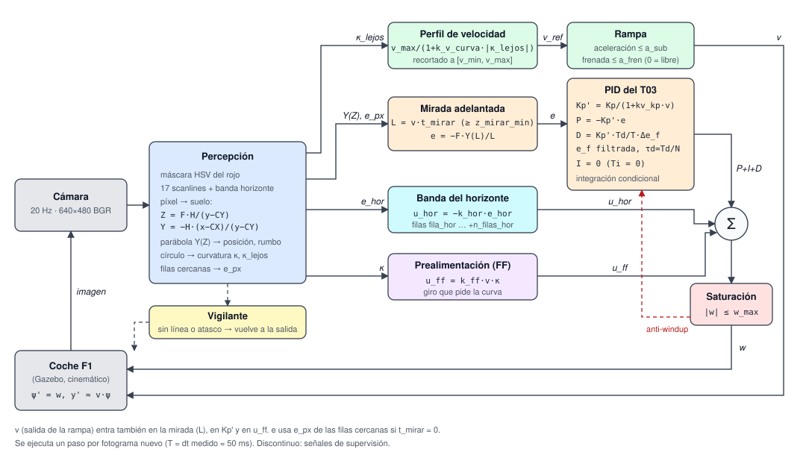
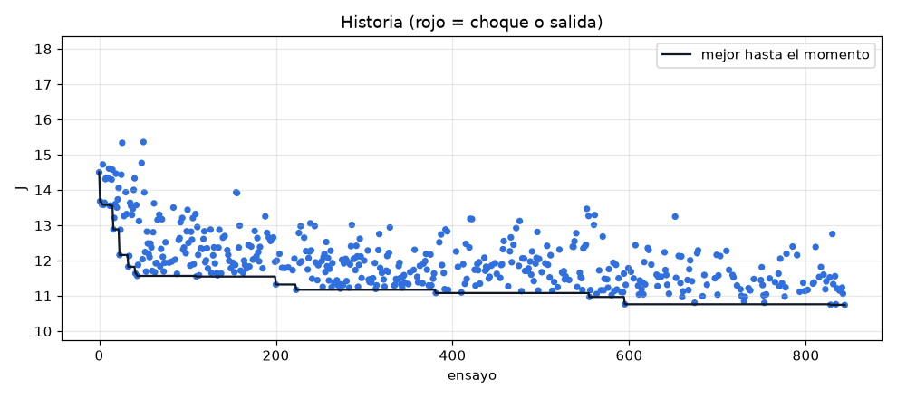
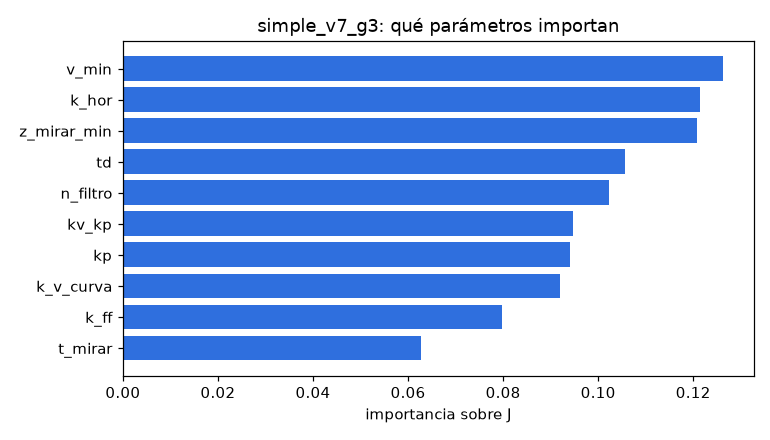
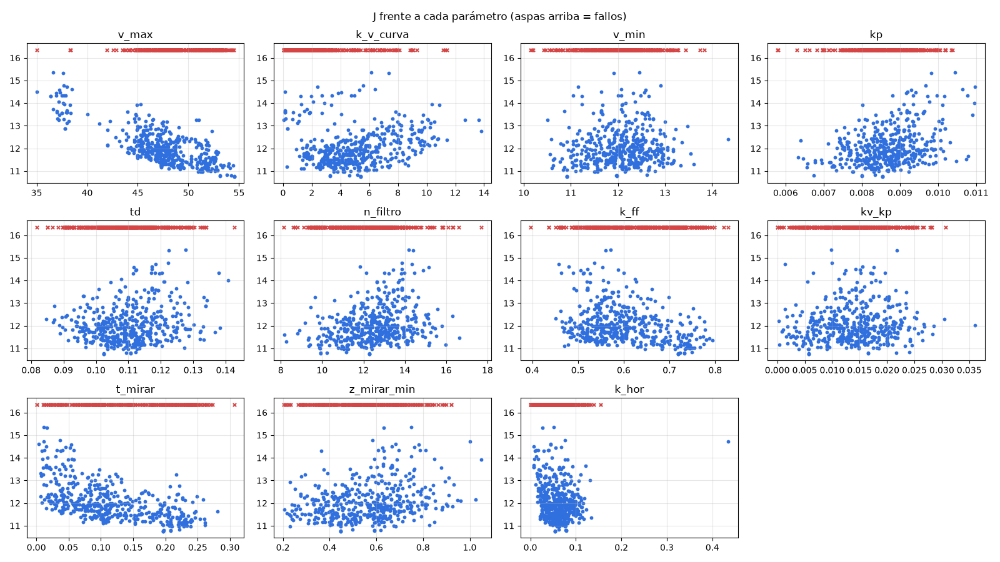
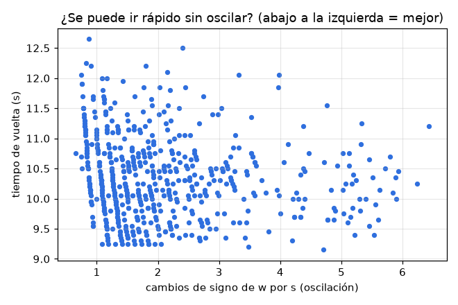
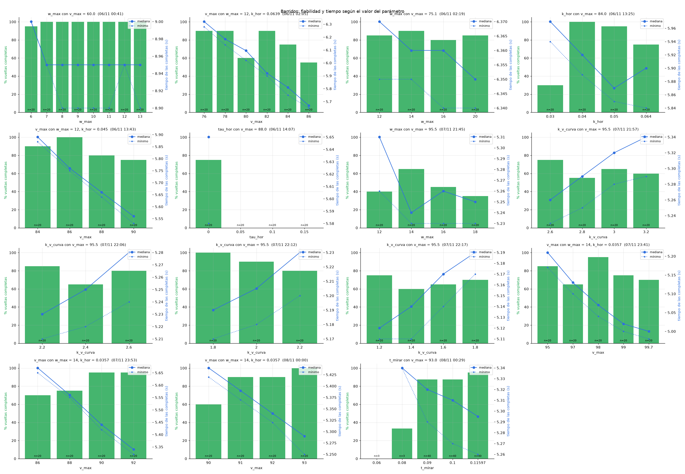
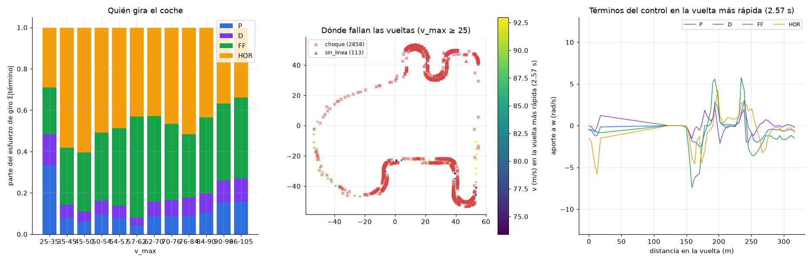
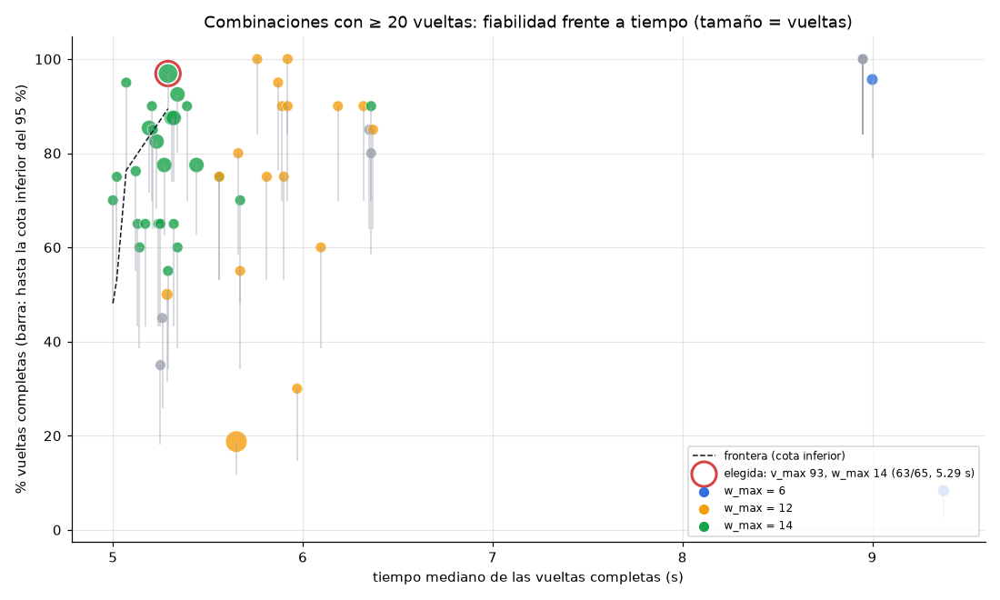

# SJK001 · Follow Line F1 con PID

Controlador para el ejercicio **Follow Line** de JdeRobot Robotics Academy (ROS 2 Humble + Gazebo Harmonic). Un F1 sigue la línea roja del circuito usando solo su cámara. El controlador es un **PID discreto** con varios añadidos que se explican abajo: mirada adelantada, prealimentación, banda del horizonte y perfil de velocidad. Sus parámetros se ajustan con un panel en vivo, con un optimizador bayesiano y con barridos de un parámetro.

| Etapa | Vuelta al circuito *simple* |
|---|---|
| Control P (fase 1, v = 10 m/s) | 43.4 s |
| PID ajustado a mano (v = 22) | 20.2 s |
| + banda del horizonte + optimizador | 15.1 s |
| Optimizador con ventana móvil y mejores por repeticiones (v ≈ 56–60, w_max = 6) | 8.95 s (3 de 3 vueltas) |
| Giro máximo `w_max` de 6 a 12 rad/s y estudio nuevo `simple_v4` (v ≈ 75) | 6.4 s (3 de 3) · mejor vuelta 6.25 s |
| Barrido de `v_max` con los parámetros de `simple_v4` (v = 82) | 5.92 s (mediana, 18 de 20 vueltas) |
| Barridos de `k_hor` (0.045 a 84 m/s) y de `v_max` (v = 86) | 5.76 s (mediana, 20 de 20) · 5.56 s a v = 90 (15 de 20) |
| Estudio `simple_v5` (v ≈ 95.5, 1338 ensayos) | 5.25 s (4 de 4) · mejor vuelta 5.18 s |
| Barridos sobre #775: `w_max` = 14 y `k_v_curva` bajo | 5.19 s (mediana, 34 de 40) · 5.12 s con k_v_curva = 1.2 (15 de 20) |
| Estudio `simple_v6` (v ≈ 99, 719 ensayos) | ~5.0 s de mediana con el 60–76 % de vueltas completas · mejor vuelta 4.94 s |
| **Final:** barridos de fiabilidad, `simple_v7` y macroanálisis (v = 93, w_max = 14) | **5.29 s (mediana, 63 de 65 vueltas, 97 %)** · valores por defecto del controlador |

Todos los tiempos incluyen **0.35 s de reinicio**: el cronómetro arranca al pedir la vuelta a la salida, y el simulador tarda ese tiempo en colocar el coche (ver §3.1). El 5.29 s son 4.94 s de conducción.

El plan, las medidas y las decisiones paso a paso están en [`docs/PLAN.md`](docs/PLAN.md). El análisis de todos los ensayos (qué parámetros importan, hacia dónde tiende el PID y qué limita la vuelta) está en [`docs/ESTUDIO_PID.md`](docs/ESTUDIO_PID.md).

---

## 1. Lazo de control



En cada fotograma nuevo de la cámara (20 Hz, T ≈ 50 ms) se ejecuta un paso:

1. **Percepción.** Se busca el rojo en 17 filas fijas de la imagen (*scanlines*) y en una banda junto al horizonte. Cada píxel se pasa a metros sobre el suelo con la geometría calibrada de la cámara:

```math
Z = \frac{F\,H}{y - c_y}, \qquad Y = -\frac{H\,(x - c_x)}{y - c_y}
\qquad (F = 320\ \text{px},\ H = 0.1015\ \text{m},\ c_y = 237.45)
```

   Con esos puntos se ajusta una parábola $Y(Z)$, que da la posición y el rumbo de la línea, y un círculo, que da la curvatura $\kappa$. También se calcula $\kappa_{lejos}$, la curvatura de los puntos a más de 1.5 m. La línea se ve como mucho a $z_{max} \approx 12.7$ m.

2. **Velocidad.** Se frena según la curva que viene: $v_{ref}$ depende de $\kappa_{lejos}$ y una rampa limita la aceleración.
3. **Giro.** El PID y los términos de prealimentación dan $w$, que se satura a $\pm w_{max}$.
4. Se mandan $v$ y $w$ al coche. Un **vigilante** devuelve el coche a la salida si pierde la línea o choca.

---

## 2. La ecuación de control

### 2.1 De dónde sale el PID

Se parte del PID continuo del tema 3 (T03), con la derivada filtrada y la referencia ponderada (PID de dos grados de libertad):

```math
u(t) = K_p\big(b\,r - y\big) + \frac{K_p}{T_i}\int_0^t e\,d\tau + K_p T_d\,\frac{d e_f}{dt},
\qquad \tau_d\,\frac{d e_f}{dt} + e_f = c\,r - y,\quad \tau_d = \frac{T_d}{N}
```

Se discretiza con Euler hacia atrás, con el periodo $T$ **medido** en cada paso, porque en Python no es exacto:

```math
\begin{aligned}
I_k &= I_{k-1} + q_i\,e_k, & q_i &= K_p\,T/T_i\\
e_{f,k} &= a\,e_{f,k-1} + (1-a)\,(c\,r_k - y_k), & a &= \tau_d/(T+\tau_d)\\
D_k &= q_d\,(e_{f,k} - e_{f,k-1}), & q_d &= K_p\,T_d/T\\
u_k &= \mathrm{sat}\!\big(K_p(b\,r_k - y_k) + I_k + D_k + u_{FF,k}\big)
\end{aligned}
```

El anti-windup es por **integración condicional**: si $u$ satura y $q_i e_k$ empuja hacia la saturación, se deshace la integración de ese paso.

Aquí la referencia es la línea centrada ($r = 0$), la medida $y$ es el error en píxeles $e$ y la salida es la velocidad de giro $w$. Con $b = 1$ y $c = 0$, la D actúa solo sobre la medida y no sobre la referencia, así que no hay pico de derivada.

### 2.2 Ecuación completa del controlador

```math
\boxed{\;
w_k = \mathrm{sat}_{\pm w_{max}}\Big(
\underbrace{-K_p'\,e_k}_{P}
\;\underbrace{-\,K_p'\,T_d\,\frac{\Delta\bar e_k}{T}}_{D\ \text{filtrada}}
\;+\;\underbrace{I_k}_{=\,0}
\;+\;\underbrace{k_{ff}\,v_k\,\kappa_k}_{\text{prealimentación}}
\;\underbrace{-\,k_{hor}\,e^{hor}_k}_{\text{horizonte}}
\Big)\;}
```

con

```math
\begin{aligned}
K_p' &= \frac{K_p}{1 + k_{v}\,v_k} && \text{(ganancia según la velocidad)}\\
e_k &= -F\,\frac{Y(L)}{L}, \quad L = \max\!\big(v_k\,t_{mirar},\ z_{min}\big) && \text{(error con mirada adelantada)}\\
\bar e_k &= a\,\bar e_{k-1} + (1-a)\,e_k, \quad a = \frac{T_d/N}{T + T_d/N} && \text{(error filtrado para la D)}\\
\Delta\bar e_k &= \bar e_k - \bar e_{k-1}, \qquad \frac{\Delta\bar e_k}{T} \approx \frac{d\bar e}{dt} && \text{(derivada discreta: cambio entre dos fotogramas)}\\
\mathrm{sat}_{\pm w_{max}}(u) &= \min\!\big(\max(u,\,-w_{max}),\ w_{max}\big) && \text{(saturación: recorta } w \text{ a } [-w_{max},\,w_{max}]\text{)}\\
e^{hor}_k &= \overline{x}_{banda} - c_x && \text{(columna media de la línea en el horizonte)}\\
v_k &= \mathrm{rampa}\!\Big(\mathrm{clip}\Big(\frac{v_{max}}{1 + k_{vc}\,|\kappa_{lejos}|},\ v_{min},\ v_{max}\Big)\Big) && \text{(perfil de velocidad)}
\end{aligned}
```

### 2.3 Por qué cada término

**El problema: un doble integrador.** El coche es cinemático: el giro cambia el rumbo y el rumbo cambia la posición lateral.

```math
\dot\psi = w,\qquad \dot y \approx v\,\psi \quad\Longrightarrow\quad \frac{Y(s)}{W(s)} = \frac{v}{s^2}
```

Un doble integrador tiene −180° de fase. Con solo P, el coche hace zigzag sin parar, y además hay ≈ 100 ms de retardo entre la imagen y la acción. Para estabilizarlo hace falta **adelanto de fase**. De ahí salen casi todos los términos.

El simulador obedece casi al instante: el coche sigue el giro mandado al 98.6 % con un fotograma de retraso, y la velocidad se alcanza en un fotograma. Por eso los únicos límites son la cámara y los que pone el propio controlador.

| Término | Parámetros | Por qué está |
|---|---|---|
| **P** | `kp` | Corrige la distancia a la línea. Es la base del lazo. |
| **D filtrada** | `td`, `n_filtro` | Da adelanto de fase y amortigua el zigzag. El filtro $\tau_d = T_d/N$ suaviza los saltos de píxel entre fotogramas. Con $T = 50$ ms el filtro solo actúa si $\tau_d \gtrsim T$, es decir, si $N \lesssim T_d/T$. Con los valores óptimos ($\tau_d \approx 0.007$ s) no actúa. |
| **I** | `ti` = 0 | **Desactivada a propósito.** El coche no tiene ninguna perturbación constante que corregir (no derrapa) y la I solo resta 90° de fase. El código la mantiene con anti-windup por si se activa. |
| **Saturación y anti-windup** | `w_max` | Limita el giro. Con `w_max` = 6, a v ≈ 57 m/s, el giro iba saturado el 40–60 % del tiempo en la chicane norte (el 73 % en la mejor vuelta), donde ocurría la mayoría de choques. Con 12 (desde `simple_v4`) el coche puede entrar en curva al doble de velocidad. A 75 m/s, subirlo a 14–20 quita la saturación del todo (el coche nunca pide más de ~16.5 rad/s), pero las vueltas completas no cambian y el tiempo solo mejora 0.02 s. El anti-windup evita que la I se cargue mientras $w$ está saturada. |
| **Mirada adelantada** | `t_mirar`, `z_mirar_min` | El error se mide a $L = v\,t_{mirar}$ metros por delante (como *pure pursuit*). Como $e \approx F\,(y + L\psi)/L$ incluye el rumbo, añade un **cero en** $s = -1/t_{mirar}$: adelanto de fase **sin derivar ruido**. Tiene un techo: la cámara ve la línea hasta 12.7 m, solo 0.17 s a 76 m/s. Por eso el óptimo se ha quedado en $t_{mirar} \approx 0.11$ s ($L \approx 8.5$ m). |
| **Prealimentación (FF)** | `k_ff` | Para recorrer una curva de curvatura $\kappa$ a velocidad $v$ hace falta exactamente $w = v\,\kappa$. Sin FF, el P necesitaría un error permanente para producir ese giro. En teoría $k_{ff} = 1$, pero κ se mide por delante del coche. Con `w_max` = 6 el óptimo subía con v hasta ≈ 0.9; con 12 baja a ≈ 0.6, porque la realimentación ya no satura y una FF alta sobrecorrige. |
| **Banda del horizonte** | `k_hor`, `fila_hor`, `n_filas_hor` | Las filas que tocan el horizonte ven la curva antes que el resto, cuando el error cercano aún es casi 0. Se suma como prealimentación, fuera de la D, para empezar a girar antes. A alta velocidad aporta casi la mitad del giro. Su óptimo es 0.04–0.065: por debajo de 0.02 casi ninguna vuelta se completa, y por encima de 0.08 hace zigzag. **Es el límite actual:** a más de ~80 m/s la línea en el horizonte salta hasta ~130 px entre fotogramas y, sin filtro, el término mete 7–8 rad/s de golpe. Domina el giro en el 61 % de los fallos. En la imagen de la web se ve como una banda azul. |
| **Ganancia según la velocidad** | `kv_kp` | La ganancia del lazo crece con $v$ (por $Y/W = v/s^2$). Bajar $K_p$ a alta velocidad mantendría el mismo margen de estabilidad, pero el optimizador lo ha dejado en ≈ 0.004 (casi sin efecto): prefiere una realimentación más rígida. |
| **Perfil de velocidad y rampa** | `v_max`, `k_v_curva`, `v_min`, `a_sub`, `a_fren` | El tiempo de vuelta es ≈ 426 m / v. Con `w_max` = 6 había que frenar mucho en curva (`k_v_curva` ≈ 7, unos 29 m/s en las chicanes). Con 12 casi no se frena (`k_v_curva` ≈ 2, nunca por debajo de ~57 m/s) y el tiempo depende casi solo de `v_max`. |
| **Vigilante** | `t_perdida_max`, `t_atasco` | Si se pierde la línea o se atasca contra la pared, el coche vuelve solo a la salida. Así el optimizador puede encadenar cientos de vueltas sin intervención. |

---

## 3. Herramientas para estudiar el PID

### 3.1 Panel en vivo (`tools/panel.sh` → http://localhost:8050)

Recibe la telemetría del controlador en cada fotograma, cambia parámetros sin reiniciar y graba todo en `logs/`.

| Gráfica | Para qué sirve |
|---|---|
| **Error lateral**: `e`, `e_ctl`, `e_hor`, `L` | Ver si el coche oscila alrededor de la línea y comparar el error cercano con el que usa el PID (mirada) y con el del horizonte. Si `e_hor` cambia antes que `e`, el horizonte se anticipa a la curva. |
| **Giro**: `w` y sus partes P, I, D, FF, HOR; `wz` real | Ver qué término domina en cada tramo. Si \|D\| > \|P\| en recta, la D está amplificando el zigzag. Si `wz` no sigue a `w`, el coche no obedece (choque o saturación). |
| **Velocidad**: `v`, `v_ref`, `vx` real | Comprobar el perfil de frenado en las curvas. |
| **Curvatura**: κ, κ_lejos y κ real (`wz/vx`) | Validar la percepción: κ debe adelantarse a la curvatura recorrida y tener su misma escala. |
| **Percepción y tiempo**: puntos válidos, `dt`, `t_perc` | Detectar fotogramas perdidos o lentos. Con `dt` = 50 ms siempre y `t_perc` ≈ 1.2 ms, el cuello de botella es la cámara, no el cálculo. |
| **Mapa** de la vuelta coloreado por \|e\| | Localizar en qué curva concreta se pierde precisión. |
| **Tabla de vueltas** | Tiempo, e_rms, cambios de signo de w por segundo (oscilación) y los parámetros de cada vuelta. Un clic recarga esos parámetros. |
| **Dispersión parámetro → métrica** | Ver qué parámetro afecta a qué métrica entre vueltas. |

**Cronómetro.** Una vuelta empieza al pedir la vuelta a la salida y termina al pasar de nuevo junto a ella, a menos de 2.5 m, tras haberse alejado más de 30 m. A más de ~70 m/s el coche avanza más de 3.5 m por fotograma y podría saltarse ese círculo. Por eso el paso por meta se busca en el **tramo entre dos fotogramas** y el instante se interpola, con resolución menor que un fotograma (`tests/test_vueltas.py`). El tiempo incluye siempre los 0.35 s que tarda el simulador en colocar el coche: es constante, así que no cambia qué parámetros son mejores.

### 3.2 Optimizador bayesiano (`tools/optimizar.sh [config]`)

Optuna (TPE) lanza vueltas una tras otra desde el panel y minimiza

```math
J = t_{vuelta} + 0.5\,\frac{e_{rms}}{100} + 0.1\cdot\text{cambios de signo de } w/\text{s},
\qquad J_{fallo} = 60\,(2 - \text{fracción recorrida})
```

1 s de vuelta pesa como 200 px de e_rms o 10 cambios de signo por segundo, así que manda el tiempo. Además:

- Desde el panel se le pueden **proponer ensayos en caliente** (botón «Probar en el optimizador»).
- La **ventana de búsqueda se desplaza sola** cuando los mejores ensayos se acercan a un borde, así que no hay techo para ningún parámetro.
- Con `repetir` = N (config), un candidato que completa su vuelta **se repite enseguida hasta N veces** y se deja al primer fallo: los buenos se miden con una tanda y los malos cuestan una sola vuelta.
- Cada 10 ensayos **repite uno de los mejores** para comprobar que no fue suerte. Los mejores se ordenan por la **J media de todas sus repeticiones**: un choque cuenta ~75, así que unos parámetros que completan 2 de 24 vueltas ya no pasan por buenos por una vuelta con suerte.

| Configuración | Estudio | Qué cambia |
|---|---|---|
| `tools/optimizador/config.json` | `simple_v3` | w_max = 6. 1790 ensayos y 6 generaciones; mejor resultado 8.95 s (3/3) |
| `tools/optimizador/config_v4.json` | `simple_v4` | w_max = 12, sin importar `simple_v3` (sus fallos se debían a la saturación) y ventanas centradas en su mejor. 273 ensayos, 94 % de vueltas completas |
| `tools/optimizador/config_v5.json` | `simple_v5` | v_max en [84, 92], k_hor en [0.035, 0.06] y ventanas de ±20 % alrededor de `simple_v4` #194. Cada candidato se confirma 5 veces. 1338 ensayos (g0–g6): la ventana de v_max subió sola hasta 93–102, con 5.25 s en 4 de 4 a v_max = 95.5 |
| `tools/optimizador/config_v6.json` | `simple_v6` | w_max = 14 fijo, k_v_curva en [1.0, 2.2], v_max en [93, 100] y ±20 % alrededor de #775. 719 ensayos: ~5.0 s de mediana a v_max ≈ 99, pero 60 % de vueltas completas |
| `tools/optimizador/config_v7.json` | `simple_v7` | **Fiabilidad:** v_max fija en 93, J con más peso a la estabilidad (peso_e_rms 2.0, peso_cambios_w 0.3) y `repetir` = 5. 1009 ensayos; mejor candidato 10/10 a 5.30 s con e_rms 213 |

`tools/optimizar.sh --informe simple_v4` genera estas gráficas (las de abajo son de `simple_v4_g7`, 266 ensayos):

| | |
|---|---|
|  | **Historia.** J de cada ensayo y el mejor hasta el momento. Cada escalón de la línea negra es una mejora, y cada uno coincide con un desplazamiento de la ventana de `v_max` (64 → 80). Casi no hay fallos (puntos rojos): con `w_max` = 12 la zona buena es mucho más ancha que en `simple_v3`. |
|  | **Importancia (fANOVA).** Cuánto explica cada parámetro de la variación de J: `v_max` 0.27, `td` 0.24, `t_mirar` 0.10 y `k_v_curva` 0.09. El peso de `td` se debe en parte a que los primeros ensayos, más lentos, tenían `td` alto. Separando tiempo y fiabilidad, el tiempo lo explican `v_max` (0.72) y `k_v_curva` (0.26) (`docs/ESTUDIO_PID.md` §11). |
|  | **J frente a cada parámetro.** Dónde está la zona buena de cada uno (las aspas rojas de arriba son vueltas fallidas). J baja casi en línea recta con `v_max` y sube con `k_v_curva` y `k_ff`. El resto se concentra en una franja estrecha: `td` ≈ 0.085, `n_filtro` ≈ 12, `t_mirar` ≈ 0.11, `k_hor` ≈ 0.065. |
|  | **Tiempo frente a oscilación.** El compromiso entre ir rápido y no hacer zigzag; abajo a la izquierda es mejor. A más velocidad, más cambios de signo de w por segundo (2–4 a 75 m/s, frente a 1–2 a 57). |

### 3.3 Barridos de un parámetro (`tools/barrido.sh`)

Prueba varios valores de **un parámetro** con el resto fijo, N vueltas por valor (20 por defecto). Cada ronda recorre todos los valores en un orden barajado distinto, para que una deriva del simulador afecte a todos por igual. Se puede reanudar (`--salida <csv>`), y `--resumen <csv>` imprime la tabla. Necesita el optimizador parado.

```bash
tools/barrido.sh --base optuna_simple_v3 --param w_max --valores 6,7,8,9,10,11,12,13
tools/barrido.sh --base optuna_simple_v4 --param v_max --valores 76,78,80,82,84,86 --fijar w_max=12
```



- **`w_max`** (base de 8.95 s): con 7 o más se completan 140 de 140 vueltas (con 6, 19 de 20), y a partir de 9 desaparece la saturación. El tiempo no cambia porque el perfil de velocidad era el mismo en todos. Es lo que llevó a `simple_v4`.
- **`w_max` a 75 m/s** (base de 6.4 s, valores 12, 14, 16 y 20): la saturación baja del 8 % al 0 % y el tiempo mejora 0.02 s, pero las vueltas completas se quedan en el 80–90 %. Los fallos de este régimen no vienen del giro máximo, sino del horizonte (ver §4).
- **`v_max`** (base de 6.4 s, 6 valores × 20 vueltas): el tiempo baja ~0.065 s por cada m/s (6.32 s a 76 → 5.67 s a 86). A 76, 78 y 82 m/s se completa el 90 % de las vueltas; a 80, el 60 %; a 84, el 75 %; y a 86, el 55 %. Los fallos se concentran en la chicane sur (~42 m) y en la chicane norte y la curva final (320–371 m).

### 3.4 Análisis fuera de línea

- `tools/optimizador/macro_analisis.py`: análisis de todos los ensayos, barridos y telemetría, con una sección final que elige la mejor combinación (figura 10). Calcula la importancia de cada parámetro por separado para el tiempo, la fiabilidad y la oscilación (bosques aleatorios con validación cruzada), la tendencia de los buenos parámetros con la velocidad, qué término del control hace el trabajo y dónde y por qué falla el coche. Escribe las figuras en `docs/img/estudio/`. Resultados en [`docs/ESTUDIO_PID.md`](docs/ESTUDIO_PID.md).
- `analysis/kappa_vs_trayectoria.py`: correlaciona la κ que ve la cámara con la curvatura que recorre el coche (odometría). Da el adelanto real de la percepción y comprueba que la escala es ≈ 1.
- `tools/resumen_log.py`: resumen de un log (error, giro, oscilación y fotogramas perdidos).
- `tools/bench_percepcion.py`: coste en ms de la percepción.



*Izquierda:* reparto del giro entre los términos. A partir de 35 m/s, P y D aportan solo el 8–18 %; el resto lo ponen la prealimentación y el horizonte. *Centro:* dónde fallan las vueltas, casi todas en las dos chicanes. *Derecha:* los términos en la vuelta más rápida (5.65 s).

---

## 4. Mejores parámetros

**Elegidos en el macroanálisis final y puestos como valores por defecto de `src/follow_line.py`** (preset `w14_v93_v6`): **5.29 s de mediana y 63 de 65 vueltas completas (97 %)**. De las 4599 combinaciones probadas, es la de mayor fiabilidad demostrada (cota inferior del 95 % de su tasa de vueltas completas: 89 %), y ninguna es a la vez más rápida y más fiable (`docs/ESTUDIO_PID.md` §18). Basta con pegar `src/follow_line.py` y pulsar play.



| Parámetros | v_max | k_v_curva | v_min | kp | td | n_filtro | k_ff | kv_kp | t_mirar | z_mirar_min | k_hor | w_max | ti |
|---|---|---|---|---|---|---|---|---|---|---|---|---|---|
| **Elegida, por defecto (5.29 s, 63/65)** | **93** | **1.697** | **7.79** | **0.01139** | **0.0632** | **7.42** | **0.643** | **0.00054** | **0.116** | **0.370** | **0.0357** | **14** | **0** |
| `simple_v6`, la más rápida (4.99 s, 3/3; 70–76 % con 20 vueltas) | 99.7 | 1.697 | 7.79 | 0.01139 | 0.0632 | 7.42 | 0.643 | 0.00054 | 0.116 | 0.370 | 0.0357 | 14 | 0 |
| #775 con w_max 14 y k_v_curva 1.8 (5.19 s, 34/40) | 95.5 | 1.8 | 9.79 | 0.0103 | 0.0782 | 10.3 | 0.657 | 0.0038 | 0.124 | 0.385 | 0.0438 | 14 | 0 |
| `simple_v5` #775 (5.25 s, 4/4) | 95.5 | 2.63 | 9.79 | 0.0103 | 0.0782 | 10.3 | 0.657 | 0.0038 | 0.124 | 0.385 | 0.0438 | 12 | 0 |
| `simple_v4` #194 en el barrido (5.76 s, 20/20) | 86 | 2.24 | 10.5 | 0.00860 | 0.0858 | 12.1 | 0.598 | 0.0033 | 0.105 | 0.462 | 0.045 | 12 | 0 |

**Qué limita ahora la vuelta:**

- **La chicane norte (300–370 m) por encima de ~95 m/s.** Allí el coche llega a separarse ~250 px de la línea (de 320 que caben en la imagen) incluso en las vueltas que terminan; en las que chocan pierde parte de la línea hacia los 302 m y no se recupera. Por eso la velocidad elegida es 93 m/s: de 95 a 99.7 completa el 65–85 %, y a 93 el 97 % (`docs/ESTUDIO_PID.md` §17).
- **La primera curva (~43 m y ~72 m).** Va al límite en todas las vueltas: a 93–95 m/s el coche la ve solo ~2 fotogramas antes, y el resultado depende del fotograma en que la detecta. Es la causa de casi todos los fallos que quedan (~1 de cada 30 vueltas).
- **Cómo gira, más que cuánto corre.** Con w_max = 14, la fiabilidad depende sobre todo de `td` (31 %) y `k_hor` (14 %), y casi nada de v_max dentro de 93–100. Subir td a ~0.07 y k_hor a ~0.04 parece dar algo más de fiabilidad, pero falta confirmarlo (`docs/ESTUDIO_PID.md` §18).
- **La cámara.** Ve la línea a 12.7 m como mucho: 3 fotogramas de anticipación a 86 m/s y 2.7 a 95.
- **La banda del horizonte.** Su ganancia buena baja con la velocidad (0.064 a 75 m/s, 0.04–0.045 a 84–96). Filtrar `e_hor` no sirve: retrasarlo un fotograma vuelve inestable el giro (0 de 20 vueltas, `docs/ESTUDIO_PID.md` §14).
- **El cálculo no limita.** La percepción tarda ≈ 1.2 ms, así que pasar el controlador a C++ no mejoraría la vuelta (`docs/PLAN.md` §5.8).

---

## 5. Uso

```bash
# Simulador (contenedor con GPU)
docker run -d --rm --name robotics --device /dev/dri --gpus all \
  -p 6080-6090:6080-6090 -p 7163:7163 jderobot/robotics-backend:latest

tools/panel.sh                                   # panel en http://localhost:8050
# En unibotics.org (ejercicio Follow Line, simulador local): pegar src/follow_line.py y pulsar play.
# Arranca con los parámetros elegidos (5.29 s); el panel no hace falta para correr.
# El puerto 7163 es la conexión de la web con el contenedor, no una página.
tools/optimizar.sh tools/optimizador/config_v7.json   # optimizador (opcional)
tools/optimizar.sh --informe simple_v7                # informe del estudio
tools/barrido.sh --help                               # barrido de un parámetro
uv run --with pandas --with scikit-learn --with matplotlib --with scipy \
  python tools/optimizador/macro_analisis.py          # macroanálisis → docs/img/estudio/
tools/test.sh                                         # pruebas
```

| Ruta | Contenido |
|---|---|
| `src/follow_line.py` | Controlador completo: percepción, PID, telemetría y recuperación. Se pega tal cual en la web. |
| `tools/panel/` | Panel web en vivo (aiohttp + uPlot), cronómetro de vueltas y presets de parámetros. |
| `tools/optimizador/` | Optimizador (Optuna) y sus configuraciones, informe, barridos y macroanálisis. |
| `tools/sim/` | Utilidades del simulador: calibración de la cámara y pruebas de giro. |
| `tests/` | Pruebas de percepción, control, ventana del optimizador y cronómetro. |
| `docs/PLAN.md` | Plan, teoría del T03 y registro de cada fase. |
| `docs/ESTUDIO_PID.md` | Macroanálisis: impacto de los parámetros, tendencia del PID y límites. |
