# Macroanálisis del PID y del optimizador

> **Versión final (2026-11-08).** Todas las figuras de `docs/img/estudio/` están regeneradas con los datos completos:
> **5531 ensayos** de `simple_v1`–`v7`, 15 barridos (1346 vueltas) y la telemetría de 7872 vueltas. Las figuras de
> importancia, dependencia parcial, interacciones, frontera y palancas existen para los tres regímenes de giro máximo:
> sin sufijo para `simple_v3` (w_max = 6), `_w12` para `simple_v4`–`v5` y `_w14` para `simple_v6`–`v7`. El resumen
> final y los parámetros elegidos están justo debajo; el detalle, en §17 y §18. Las secciones 0–9 se escribieron con
> los datos de `simple_v1`–`v3` (2026-11-06) y conservan sus cifras de entonces, aunque sus figuras ya incluyen todo.
>
> **Actualización 2026-11-10:** §19 añade `simple_v9`, con 576 tandas de **5 vueltas seguidas sin reiniciar**
> (figuras 12–14). Las vueltas lanzadas tardan 4.97 s, pero la fiabilidad encadenando vueltas es menor: un 92 % por
> vuelta en la mejor zona, frente al 97 % de las vueltas sueltas desde parado. Las figuras de w_max = 14 incluyen
> ahora `simple_v8` (34 ensayos).

## Resumen final

**Parámetros elegidos** (valores por defecto de `src/follow_line.py`, preset `w14_v93_v6`): **5.29 s de mediana y 63 de
65 vueltas completas (97 %)** a v_max = 93 m/s con w_max = 14. Es la combinación con mayor fiabilidad demostrada de las
4599 probadas (§18).

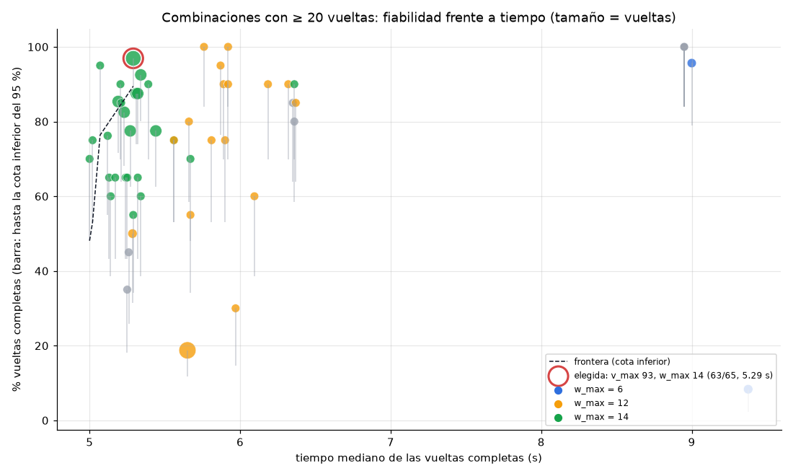

### Qué pesa en cada métrica

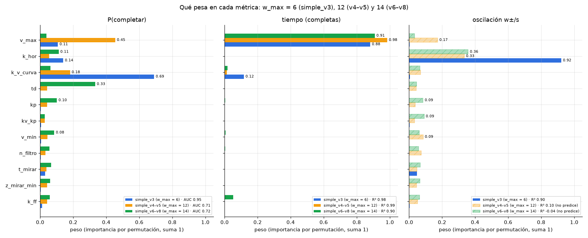

Peso de cada parámetro (importancia por permutación de un bosque aleatorio, suma 1), en los tres regímenes de w_max:

| Parámetro | Fiabilidad w6 | w12 | **w14** | Tiempo w6 | w12 | **w14** | Oscilación w6 | w12 | **w14** |
|---|---|---|---|---|---|---|---|---|---|
| `v_max` | 0.11 | **0.45** | 0.04 | **0.88** | **0.98** | **0.91** | 0.00 | 0.17 | 0.03 |
| `k_v_curva` | **0.69** | 0.18 | 0.06 | 0.12 | 0.01 | 0.02 | 0.01 | 0.07 | 0.07 |
| `k_hor` | 0.14 | 0.05 | **0.14** | 0.00 | 0.00 | 0.00 | **0.92** | 0.33 | 0.34 |
| `td` | 0.00 | 0.04 | **0.31** | 0.00 | 0.00 | 0.00 | 0.00 | 0.04 | 0.05 |
| `kp` | 0.00 | 0.04 | 0.11 | 0.00 | 0.00 | 0.00 | 0.00 | 0.04 | 0.09 |
| `k_ff` | 0.01 | 0.04 | 0.06 | 0.00 | 0.00 | 0.05 | 0.00 | 0.05 | 0.06 |
| `t_mirar` | 0.03 | 0.04 | 0.07 | 0.00 | 0.00 | 0.00 | 0.05 | 0.05 | 0.07 |
| `v_min`, `n_filtro`, `z_mirar_min`, `kv_kp` | ≤ 0.01 | ≤ 0.04 | 0.02–0.07 | 0.00 | 0.00 | 0.00 | 0.00 | 0.03–0.09 | 0.06–0.10 |
| *Calidad del modelo* | *AUC 0.96* | *0.71* | *0.72* | *R² 0.98* | *0.99* | *0.90* | *R² 0.90* | *0.10* | *< 0* |

Cómo leerla:

1. **El tiempo es v_max** en los tres regímenes (88–98 %). Con w_max = 6 también contaba cuánto frenar en curva
   (`k_v_curva`, 12 %); con más giro disponible el coche ya casi no frena y deja de importar.
2. **La fiabilidad cambia de dueño con w_max.** Con 6, la decidía cuánto frenar en curva (`k_v_curva`, 69 %): el giro
   saturaba y solo frenando se pasaban las chicanes. Con 12, la velocidad (`v_max`, 45 %). Con 14, **cómo gira el
   PID**: `td` (31 %), `k_hor` (14 %) y `kp` (11 %). Es la primera vez que el PID clásico pesa: con giro de sobra, lo
   que decide es la calidad del lazo.
3. **La oscilación es `k_hor`** (92 % con w_max = 6). En los regímenes rápidos el modelo ya no la predice (R² ≤ 0.10):
   a 75–100 m/s el zigzag depende más de la vuelta que de los parámetros, y esos pesos no son de fiar (barras rayadas
   en la figura).
4. **Cada vez hay más azar.** La fiabilidad se predice muy bien con w_max = 6 (AUC 0.96) y regular en los rápidos
   (0.71–0.72). A v_max ≥ 97 no se predice nada (AUC 0.46): lo que pasa en la primera curva y en la chicane norte
   depende del fotograma en que el coche ve la curva. Por eso la decisión final se tomó con muchas vueltas por
   combinación y no con el modelo.

### Conclusiones

- **De 43.4 s a 5.29 s fiables** (y ~5.0 s con el 60–76 % de vueltas completas a v_max ≈ 99). La mejora vino en tres
  saltos de estructura: la banda del horizonte (v ≈ 30), liberar el giro máximo (w_max 6 → 12 → 14) y subir v_max con
  el PID reajustado a cada velocidad.
- **El controlador acabó siendo de anticipación:** a más de 35 m/s, P y D aportan solo el 8–27 % del giro; el resto lo
  ponen la prealimentación y el horizonte (figura de telemetría, §18). Pero con w_max = 14 el PID decide si la vuelta
  termina.
- **Lo que limita ahora** es la cámara (20 Hz y ~12.7 m de alcance: la primera curva se ve solo ~2 fotogramas antes)
  y la chicane norte por encima de ~95 m/s.

---

**Foto del 2026-11-06 a las 00:15**, con el optimizador todavía en marcha (`simple_v3_g6`).
Datos: **2076 ensayos** de `simple_v1`, `simple_v2` y `simple_v3` (g0–g6), con 1295 vueltas completas y 781 fallos
(731 choques, 45 salidas de línea, 5 por tiempo), más la telemetría por fotograma de **1827 vueltas** a v_max ≥ 25.

Para regenerar todas las cifras y figuras (solo lee los CSV, se puede lanzar con el optimizador en marcha):

```bash
uv run --with pandas --with scikit-learn --with matplotlib --with scipy python tools/optimizador/macro_analisis.py
```

---

## 0. Resumen de `simple_v1`–`v3` (2026-11-06)

1. **El PID clásico ya no decide nada.** `kp`, `td`, `n_filtro`, `kv_kp` y `z_mirar_min` tienen una importancia ≈ 0
   sobre el tiempo, la fiabilidad y la oscilación dentro de sus ventanas actuales. En la pista, P + D aportan solo
   el **~14 %** del giro a alta velocidad. El otro **~86 %** lo ponen la prealimentación (FF) y la banda del
   horizonte (HOR).
2. **Tres parámetros explican casi todo:**
   - `v_max` decide el **tiempo** (88 % de la importancia).
   - `k_v_curva`, cuánto frenar en curva, decide **si se completa la vuelta** (69–83 %).
   - `k_hor` decide la **oscilación** (93 %) y es el segundo factor de fiabilidad.
3. **El límite ya no es v_max sino las dos chicanes.** El **91 %** de los fallos de `simple_v3` ocurre en ellas. La velocidad media se ha
   quedado en **~44 m/s** aunque v_max suba de 54 a 60: subir v_max ya casi no da tiempo.
4. **El giro satura en las chicanes.** `w_max` = 6 rad/s está fijo desde que a v = 30 saturaba el 0.4 % del tiempo.
   Hoy satura el **10–18 % de la vuelta** y el 41–60 % del paso por la chicane norte. El coche sí obedece `w`
   hasta 6 (wz/w ≈ 0.985), así que este límite lo pone el controlador, no el simulador. Es el parámetro sin
   explorar con más potencial.
5. **El resultado de una vuelta es casi una moneda al aire en el borde.** Con los mismos parámetros, el tiempo se
   repite con ±0.025 s (medio fotograma), pero completar o no se repite solo el 44–48 % de las veces a
   v_max 45–56. Una vuelta suelta no dice si unos parámetros son buenos.
6. **Mejor fiable actual: 9.10 s en 3 de 3 vueltas** (dos grupos, v_max 56.9 y 57.6). Mejora el 9.25 s del
   README. Hay 12 grupos 3/3 entre 9.10 y 9.33 s. La mejor vuelta suelta es de 8.95 s.
7. **g6 está estancada:** en 450 ensayos, la tasa de vueltas completas sigue en ~50 % y el mejor tiempo solo baja de
   9.2 a 8.95 s. Para seguir mejorando hay que cambiar la estructura (w_max, dimensiones, objetivo), no solo
   seguir buscando.

---

## 1. Evolución de la búsqueda

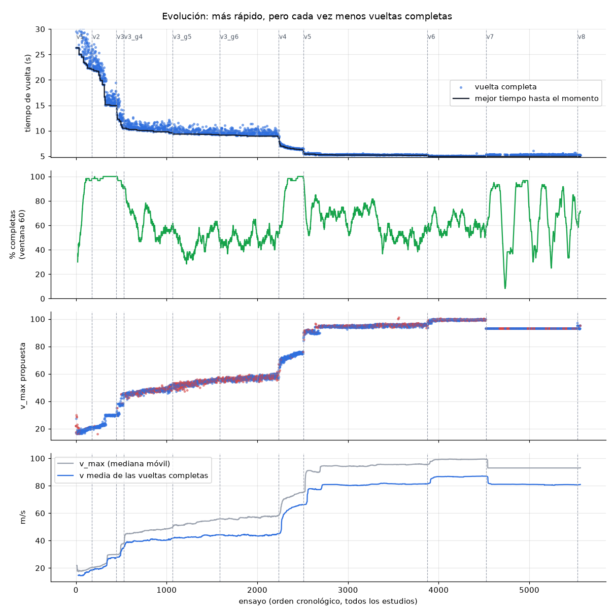

| Estudio | Ensayos | % completas | v_max mediana | Mejor vuelta | Mediana completas |
|---|---|---|---|---|---|
| simple_v1 | 178 | 85 % | 18.9 | 22.05 s | 25.8 s |
| simple_v2 | 268 | 99 % | 23.4 | 14.95 s | 19.85 s |
| simple_v3 g0–g3 | 80 | 91 % | 30–38 | 10.50 s | 12.3–15.3 s |
| simple_v3_g4 | 540 | 61 % | 47.3 | 9.60 s | 10.60 s |
| simple_v3_g5 | 518 | 46 % | 53.4 | 9.15 s | 9.85 s |
| simple_v3_g6 | 492 (en curso) | 49 % | 56.3 | **8.95 s** | 9.60 s |

- Hasta v ≈ 40 (g3), cada subida de v_max salía casi gratis: más del 90 % de vueltas completas.
- Desde g4 la búsqueda vive **en el borde de estabilidad**: el ~50 % de los ensayos falla. Es lo esperable en un
  optimizador que empuja hacia la velocidad, y además cada fallo cuesta poco tiempo (la mayoría choca a los 50 m,
  unos 2.5 s).
- La línea azul del último panel es la clave: la **velocidad media real se ha aplanado en ~44 m/s** desde v_max ≈ 54.

---

## 2. Ruido: qué se puede creer de un ensayo

| Medida | Valor |
|---|---|
| Desviación del tiempo entre repeticiones que completan | **0.025 s** de mediana, 0.035 s el p90 (54 grupos) |
| Resolución del tiempo | 0.05 s (un fotograma a 20 Hz) |
| Si la 1.ª vuelta completó, las repeticiones completan… | 96 % a v_max < 45 · **44 %** a 45–52 · **48 %** a 52–56 · 78 % a ≥ 56 (estos ya son grupos filtrados por el optimizador) |

Conclusiones:

- **El tiempo es determinista.** Dos vueltas que completan con los mismos parámetros difieren en medio fotograma.
  Una diferencia de 0.1 s entre ensayos es real.
- **Completar o no es aleatorio.** Que el coche pase la chicane depende de cómo cae la secuencia de fotogramas
  respecto a la curva. Por eso los «mejores por repeticiones» (commit 43139c8) eran necesarios, y por eso ningún
  parámetro debería darse por bueno con menos de 3 vueltas completas.

---

## 3. Qué parámetros tienen más impacto

Método: un bosque aleatorio por cada métrica, validado fuera de muestra con 5 particiones. La importancia de cada
parámetro es cuánto empeora el modelo al barajar ese parámetro (importancia por permutación), normalizada a suma 1.
Los modelos predicen bien: AUC 0.95 para completar, R² 0.98 para el tiempo y R² 0.90 para la oscilación, así que las
importancias son fiables. La correlación de Spearman da el signo, pero mezcla efectos: por ejemplo, `kp` correlaciona
con el tiempo solo porque bajó a la vez que subía v_max.

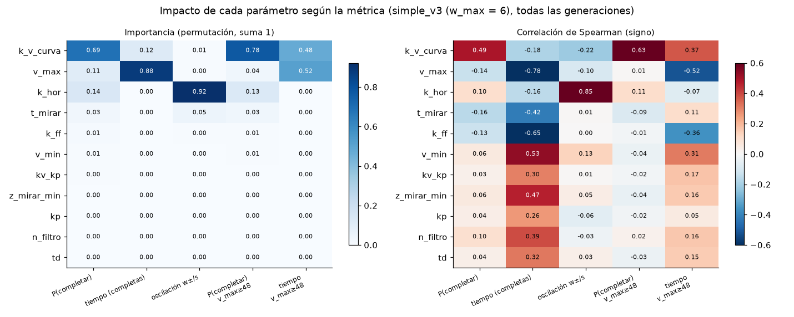

### Jerarquía de impacto

| Nivel | Parámetro | Sobre qué actúa | Efecto |
|---|---|---|---|
| **1** | `v_max` | Tiempo (0.88) | Más rápido, menos fiable, con rendimiento decreciente por encima de ~55 |
| **1** | `k_v_curva` | Completar (0.69; **0.78–0.83** en régimen rápido) y tiempo (0.50 a v ≥ 48) | Es la palanca fiabilidad ↔ tiempo |
| **1** | `k_hor` | Oscilación (0.93) y completar (0.12–0.14) | Tiene un punto óptimo en 0.03–0.05 |
| 2 | `t_mirar` | Completar (0.03) y oscilación (0.04) | Efecto pequeño, limitado por el alcance de la cámara (§6) |
| 2 | `k_ff`, `v_min` | ≈ 0.01 | Dentro de su ventana apenas importan (ya están bien ajustados) |
| 3 | `kp`, `td`, `n_filtro`, `kv_kp`, `z_mirar_min` | ≈ 0.00 en las tres métricas | **Planos:** cualquier valor de la ventana actual sirve |

El análisis con magnitudes físicas en lugar de los parámetros crudos da lo mismo. Con `v_curva`, la velocidad de
consigna en κ = 0.05 (`v_max / (1 + 0.05·k_v_curva)`), el reparto es: completar ← v_curva 0.77, k_hor 0.15; tiempo
← v_max 0.76, v_curva 0.23. La mirada efectiva (`L_max`), la ganancia del lazo (`Kp_ef·v`) y la constante del
filtro de la D (`τ_d`) no aparecen.

> **Diferencia con el fANOVA del README** (v_max 0.21, k_ff 0.15, k_v_curva 0.15, v_min 0.14…). El fANOVA de Optuna
> se calcula sobre J dentro de una sola generación. J mezcla dos fenómenos muy distintos: unos 10 puntos si completa
> y unos 115 si choca. Además, TPE concentra las muestras. Si se separan tiempo y fiabilidad, el reparto queda
> mucho más concentrado. En g6 sola, la importancia sobre J da k_v_curva 0.60, k_hor 0.30 y el resto ≤ 0.04.

### Efecto de cada parámetro (dependencia parcial)

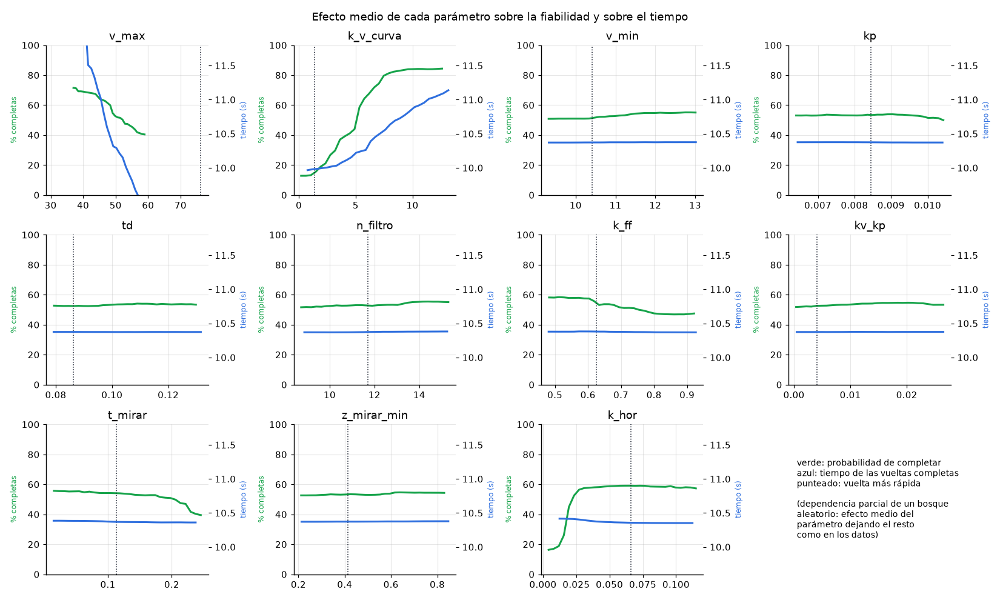

Lectura: la curva verde (% completas) y la azul (tiempo, misma escala en todos los paneles) solo se mueven de verdad en
`v_max`, `k_v_curva` y `k_hor`. En los demás, las dos curvas son planas.

### Interacciones

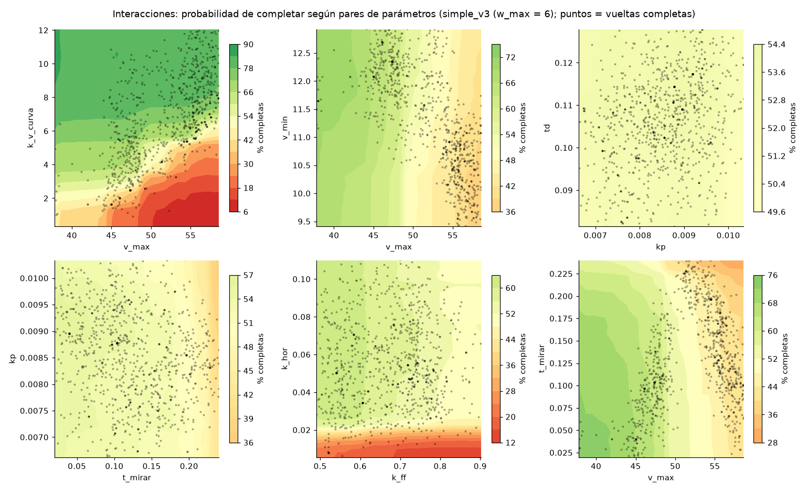

- **v_max × k_v_curva** es la única interacción fuerte. La frontera de fiabilidad sube en diagonal: cada +5 m/s de
  v_max piden ~+1.5 de k_v_curva para mantener la misma probabilidad de completar. Lo que se conserva es
  `v_curva`, la velocidad a la que se entra en la curva.
- **k_hor < 0.02** es una zona roja para cualquier `k_ff`: sin horizonte, a estas velocidades no se completa.
- **kp × td** es plano (51–55 % en todo el mapa): el PID está en una meseta.
- **v_max × t_mirar**: a partir de v_max ≈ 52, mirar más lejos (t_mirar > 0.2) empieza a restar fiabilidad.

---

## 4. Las dos palancas en el régimen rápido (v_max ≥ 54)

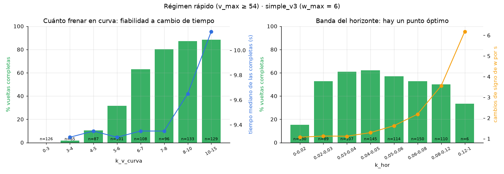

| k_v_curva | n | % completas | Tiempo mediano |
|---|---|---|---|
| 0–4 | 158 | **0–2 %** | — |
| 4–5 | 65 | 12 % | 9.32 s |
| 5–6 | 85 | 38 % | 9.30 s |
| 6–7 | 87 | **69 %** | 9.35 s |
| 7–8 | 69 | 78 % | 9.48 s |
| 8–10 | 100 | **88 %** | 9.72 s |
| 10–15 | 90 | 88 % | 10.25 s |

- `k_v_curva` funciona casi como un **interruptor**: por debajo de 5, el coche no pasa las chicanes.
- Entre 6 y 7 está el punto dulce para batir tiempos. De 8 a 10 se gana un +20 % de fiabilidad a cambio de +0.4 s.
  Pasar de 10 solo hace perder tiempo.

| k_hor | % completas | Cambios de signo de w/s |
|---|---|---|
| < 0.02 | 16 % | 1.1 |
| 0.02–0.05 | 57–65 % | 1.1–1.3 |
| 0.05–0.06 | 58 % | 1.6 |
| 0.06–0.12 | 47–49 % | 2.1–3.8 |

- La banda del horizonte es **imprescindible**, pero tiene un óptimo claro en **0.03–0.05**. Por encima de ese
  rango, el término HOR mete picos (hasta ±28 rad/s antes de saturar, ver §5) que hacen zigzag y restan fiabilidad.

---

## 5. Dónde y por qué falla

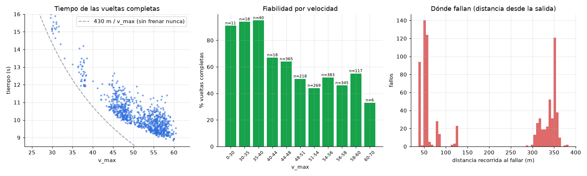
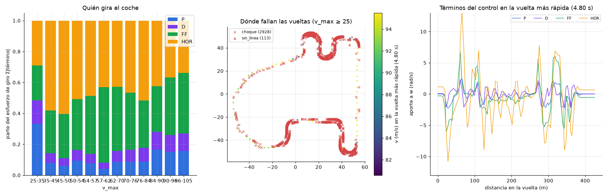

**Dónde.** El 91 % de los fallos de `simple_v3` ocurre en dos sitios. Un 44 % ocurre a 25–80 m de la salida, en la
**chicane sur** (x ≈ 40–50, y ≈ −50). Un 47 % ocurre a 300–370 m, en la **chicane norte** (x ≈ 20–40,
y ≈ 30–50). El resto del circuito apenas tiene choques.

**Por qué: el giro se satura.**

| | Pasa | Choca |
|---|---|---|
| Chicane sur: tiempo con \|w\| = w_max | 13 % | 18 % |
| Chicane norte: tiempo con \|w\| = w_max | **41 %** | **60 %** |
| Vuelta entera (v_max ≥ 54) | 11 % | 18 % |
| e_ctl rms hasta el fallo (v_max ≥ 54) | 55 px | 113 px |

En la mejor vuelta (8.95 s), el 73 % de los fotogramas de la chicane norte va con w = ±6 rad/s. A 37 m/s y
6 rad/s, el radio mínimo que puede trazar el coche es v/w ≈ 6 m. Así que el coche **no puede seguir la geometría
de la chicane** y la recorre abriéndose. Cuando la secuencia de fotogramas cae mal, se sale.

**El coche obedece mucho mejor de lo que se le pide:**

- Con |w| < w_max se cumple wz ≈ 0.94–0.985·w, con un fotograma de retraso (correlación de 0.96 con w[k−1]).
  Con w saturada, wz/w = 0.985.
- La velocidad sigue a la consigna casi al instante (el sim acepta ±200 m/s²). `a_sub` y `a_fren` no limitan nada
  físico.
- Es decir, **el modelo es cinemático**. Las limitaciones son las que pone el controlador (`w_max`) y la
  percepción (20 Hz y alcance de la cámara).

**Rendimiento decreciente de v_max:**

| v_max | % completas | Tiempo mediano | v media real | v media / v_max |
|---|---|---|---|---|
| 35–40 | 95 % | 12.58 s | 34.3 | 0.91 |
| 44–48 | 64 % | 10.70 s | 39.8 | 0.85 |
| 51–54 | 44 % | 9.90 s | 42.7 | 0.81 |
| 54–56 | 52 % | 9.60 s | 43.9 | 0.80 |
| 56–58 | 45 % | 9.57 s | 44.0 | 0.77 |
| 58–60 | 50 % | 9.52 s | 44.1 | 0.76 |

Por encima de 54, cada m/s más de v_max se gasta en frenar más en las curvas: la v media no pasa de ~44 m/s. El
tiempo en recta ya es pequeño, así que el que queda por ganar está en las chicanes.

---

## 6. Tendencia del PID

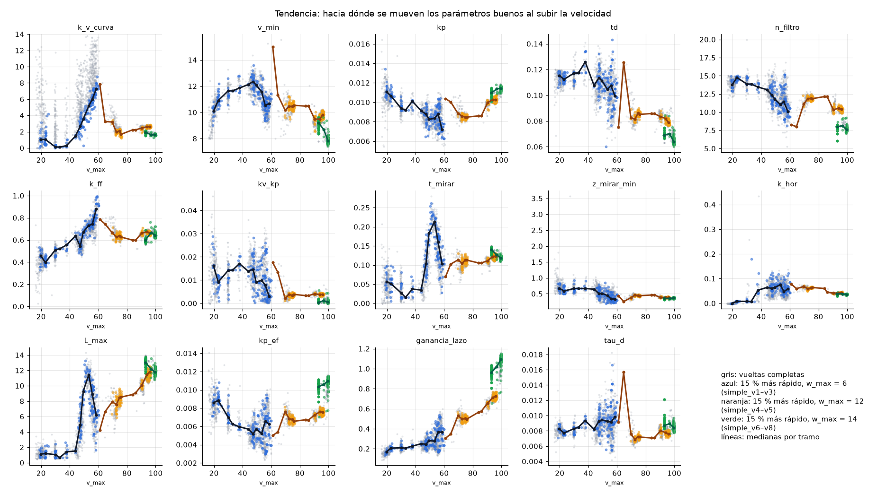

Mediana del 15 % más rápido de cada tramo de v_max:

| v_max | k_v_curva | v_min | kp | td | n_filtro | k_ff | kv_kp | t_mirar | z_mirar_min | k_hor | L_max (m) | Kp_ef·v |
|---|---|---|---|---|---|---|---|---|---|---|---|---|
| 20 | 1.0 | 10.1 | 0.0111 | 0.115 | 13.8 | 0.46 | 0.016 | 0.057 | 0.68 | 0.000 | 1.1 | 0.17 |
| 30 | 0.1 | 11.6 | 0.0094 | 0.117 | 13.9 | 0.51 | 0.014 | 0.027 | 0.67 | 0.008 | 1.0 | 0.21 |
| 47 | 2.7 | 12.3 | 0.0088 | 0.114 | 12.4 | 0.54 | 0.015 | 0.104 | 0.51 | 0.061 | 4.9 | 0.25 |
| 53 | 5.2 | 11.6 | 0.0084 | 0.105 | 11.1 | 0.73 | 0.010 | 0.214 | 0.45 | 0.075 | 11.4 | 0.28 |
| 56 | 6.0 | 10.5 | 0.0088 | 0.107 | 11.4 | 0.74 | 0.008 | 0.160 | 0.34 | 0.047 | 8.9 | 0.37 |
| 58 | 7.0 | 10.3 | 0.0079 | 0.099 | 10.6 | **0.80** | **0.002** | 0.100 | 0.34 | 0.051 | 5.8 | **0.41** |

Correlación con v_max entre los buenos: k_ff +0.93, k_v_curva +0.88, L_max +0.74, z_mirar_min −0.71,
n_filtro −0.71, Kp_ef·v +0.69, kp −0.65, t_mirar +0.63, k_hor +0.59.

### Qué cuenta esta tabla

1. **De realimentación a anticipación.** El reparto del esfuerzo de giro (Σ|término|) cambia así en las vueltas
   completas:

   | v_max | P | D | FF | HOR |
   |---|---|---|---|---|
   | 25–35 | 33 % | 15 % | 23 % | 29 % |
   | 45–50 | 6 % | 5 % | 28 % | **60 %** |
   | 57–62 | 8 % | 7 % | **38 %** | 48 % |

   A alta velocidad, el controlador es en la práctica un **controlador por anticipación con un PID de corrección
   fina**. El PID solo corrige el resto, y por eso sus ganancias dan igual dentro de la meseta.
2. **`k_ff` → 1.** Pasa de 0.46 a 0.80 casi en línea recta con v. El teórico es 1 (w = v·κ). Cuanto más rápido va
   el coche, más hay que confiar en la curvatura medida. Si la tendencia sigue, la ventana de `k_ff` (0–1.2) se
   quedará corta pronto.
3. **Frenar más en curva y correr más en recta.** `k_v_curva` pasa de ≈ 0 a 7 y `v_min` baja de 12.3 a 10.3: el
   perfil de velocidad es cada vez más agresivo en las dos direcciones.
4. **La mirada adelantada choca con la cámara.** `t_mirar` sube hasta 0.21 s a v = 53 (L ≈ 11.4 m) y luego
   **vuelve a bajar** a 0.10 s (L ≈ 5.8 m). El motivo: el alcance de la línea en la imagen es como mucho
   **z_max ≈ 12.7 m**, así que a 57 m/s la mirada no puede pasar de 0.22 s. En ese punto se recorta, y el ajuste
   parabólico lejano es más ruidoso. A partir de ahí, la anticipación lejana la da `k_hor` y la mirada se acorta.
5. **Más ganancia efectiva a más velocidad.** La teoría (Y/W = v/s²) pide bajar Kp con v para mantener el margen,
   y para eso estaba `kv_kp`. El optimizador hace lo contrario: `kv_kp` → 0 y Kp_ef·v sube de 0.17 a 0.41. Como
   el PID ya solo corrige el resto, una realimentación más rígida ayuda a no abrirse en las chicanes, donde se satura.
6. **Menos filtro en la D.** `n_filtro` baja de 14 a 10.6, mientras `td` se queda en ~0.10–0.12.
   τ_d = td/N ≈ 0.009 s, muy por debajo de T = 0.05 s, así que **el filtro de la D no actúa** (ya lo avisaba el
   README: solo actúa si N ≲ Td/T ≈ 2). Que `n_filtro` tenga importancia 0 lo confirma.

---

## 7. Límites estructurales

| Límite | Valor | Consecuencia |
|---|---|---|
| Cámara | 20 Hz: 2.85 m entre fotogramas a 57 m/s | El resultado en el borde es aleatorio (§2) |
| Alcance de la línea | z_max ≈ 12.7 m: 0.22 s de previsión a 57 m/s | Techo para `t_mirar` y para frenar con κ_lejos |
| `w_max` (lo pone el controlador) | 6 rad/s: R_min = v/6 | Satura en las chicanes, origen de la mayoría de choques |
| Retardo de actuación | 1 fotograma (50 ms) | Ya compensado por FF, HOR y la mirada |
| Cálculo | 1.2 ms | No es un límite (PLAN §5.8) |

---

## 8. Recomendaciones, por impacto esperado

1. **Liberar `w_max` (prioridad alta).** Es el único límite que no es del ejercicio y está activo justo donde
   ocurren los fallos. Propuesta: un estudio nuevo (`simple_v4`) que importe `simple_v3_g6` con `w_max` en [5, 10]
   y `valores_previos: {"w_max": 6}`. Antes conviene una prueba rápida: el preset de 9.10 s con w_max = 7, 8 y 9,
   3 vueltas cada uno, comprobando en el panel que `wz` sigue a `w` por encima de 6. Los pocos datos que hay a
   w > 6 (sesiones del día 5 de madrugada) son de choques y recuperaciones, así que no sirven para saberlo.
2. **Congelar los parámetros planos.** Fijar `kp` = 0.0085, `td` = 0.105, `n_filtro` = 11, `kv_kp` = 0.005 y
   `z_mirar_min` = 0.34 (las medianas de los buenos). Bajar de 11 a 6 dimensiones hace que TPE aprenda mucho
   antes. Al liberar `w_max` habrá que vigilarlos: con más autoridad de giro, la meseta del PID puede cambiar.
3. **Atar la velocidad en curva a v_max.** El optimizador busca por separado `v_max` y `k_v_curva`, pero lo que
   cuenta es `v_curva` (§3). Una alternativa es reparametrizar el perfil con `v_max` y una velocidad objetivo en
   curva. Así desaparece la diagonal de la figura 4 y la búsqueda es más eficiente.
4. **Ampliar ya la ventana de `k_ff`.** El techo de 1.2 está lejos todavía, pero la tendencia (+0.93 con v)
   apunta a ≥ 0.9 si se sube v en curva. La ventana móvil lo hará sola, aunque tarda.
5. **Revisar J.**
   - `e_rms` no informa: vale 227 ± 17 px en todas las vueltas, porque las filas cercanas pierden la línea el
     ~15 % del tiempo y saturan en ±300 px. Solo suma una constante de ~1.1 s. Se puede sustituir por `e_ctl` rms,
     que sí separa (55 px en las vueltas que completan frente a 113 en las que fallan), o poner su peso a 0.
   - La penalización de la oscilación castiga a `k_hor`. Con el peso actual (0.1) no molesta, pero no conviene
     subirlo.
6. **Decidir qué se quiere: récord o fiabilidad.** Para batir el récord: `k_v_curva` ≈ 6–7 (~70 %). Para una vuelta
   segura en la entrega: `k_v_curva` ≈ 8–9 (~88 %, unos +0.3–0.4 s). Ahora mismo el optimizador mezcla los dos
   objetivos.
7. **Probar otros circuitos** antes de afinar más: los parámetros que importan (v_curva, k_hor) dependen de la
   geometría de las chicanes de `simple`.

---

## 9. Limitaciones del análisis

- Los ensayos **no son independientes**: TPE muestrea donde cree que está lo bueno, así que hay muchos datos en la
  zona buena y pocos fuera. Las importancias valen para la región explorada. Que un parámetro sea «plano» quiere
  decir plano **dentro de su ventana actual**, no en todo su rango.
- Las cuatro primeras generaciones mezclan regímenes de velocidad muy distintos. Por eso hay tablas separadas para
  v_max ≥ 48 y ≥ 54.
- Las zonas de las chicanes se definen con cajas de coordenadas a mano (en `macro_analisis.py`).
- El efecto de `w_max` > 6 **no está medido**. La recomendación 1 se basa en la saturación observada y en que el
  coche obedece w = 6, no en ensayos a w > 6.

---

## 10. Barrido de `w_max` (2026-11-06, 00:41–01:10)

`tools/barrido.sh`: base = preset `optuna_simple_v3` (ensayo #1676, 8.95 s en 3/3; v_max = 60, k_v_curva = 7.6,
k_ff = 0.91). Solo cambia `w_max`, con 20 vueltas por valor en orden intercalado. Datos en
`logs/optuna/barrido_w_max_20261106-004141.csv` y telemetría en `logs/20261106-004544_panel.csv`.

| w_max | Completas | t mín | t mediano | Saturación en la vuelta | Saturación en la chicane norte | Máximo \|w\| usado | e_ctl rms |
|---|---|---|---|---|---|---|---|
| 6 | 19/20 | 9.00 | 9.00 | 17.7 % | 73 % | 6.0 | 56 px |
| 7 | 20/20 | 8.95 | 8.95 | 4.2 % | 12 % | 7.0 | 39 px |
| 8 | 20/20 | 8.90 | 8.95 | 1.1 % | 0 % | 8.0 | 38 px |
| 9–13 | 100/100 | 8.90 | 8.95 | 0 % | 0 % | 8.4–8.7 | 37 px |

- **El simulador acepta giros por encima de 6:** wz = 0.986·w[k−1] con |w| > 6.2 (2493 fotogramas).
- **La fiabilidad pasa de 95 % a 100 %** (140/140 vueltas con w_max ≥ 7). El error de seguimiento baja un 33 %.
- **El tiempo no cambia,** porque el perfil de velocidad era el mismo en todas las vueltas. La velocidad mínima en las
  chicanes (~29 m/s) la marca `k_v_curva`, no el giro. En recta el coche va topado en v_max = 60 el 30 % de la vuelta.
  El margen ganado solo se convierte en tiempo si se dejan moverse `v_max` y `k_v_curva`.
- Por encima de 9 no hay diferencias. Se fija **w_max = 12** para dejar margen cuando suba la velocidad en curva
  (hace falta w = v·κ).

**Siguiente:** estudio `simple_v4` (`tools/optimizar.sh tools/optimizador/config_v4.json`) con w_max = 12 fijo, sin
importar `simple_v3` (sus fallos eran por la saturación) y con ventanas centradas en el mejor actual, con `v_max`
de 56 a 72 y ventana móvil.

---

## 11. `simple_v4`: de 8.95 s a 6.25 s, y por qué se para ahí (2026-11-06, 01:12–01:53)

Estudio nuevo con w_max = 12 fijo y sin importar `simple_v3`: 273 ensayos y 8 generaciones de ventana. **94 % de
vueltas completas**, frente al ~50 % de `simple_v3_g6`. Mejor vuelta: 6.25 s (ensayos #262 y #264, 2/2). Mejor grupo
3/3: 6.43 s de media (preset `optuna_simple_v4`).

### Qué ha cambiado

| | simple_v3 (mejor, w_max 6) | simple_v4 (10 % mejor, w_max 12) |
|---|---|---|
| v_max | 60.0 | **75.5** |
| k_v_curva | 7.6 | **1.9** (casi no frena) |
| v mínima en la vuelta | ~29 m/s | **~57 m/s** |
| k_ff | 0.91 | **0.62** |
| k_hor | 0.043 | 0.064 |
| kp, td, n_filtro, t_mirar, z_mirar_min | 0.0063, 0.098, 10.6, 0.10, 0.47 | 0.0085, 0.085, 11.9, 0.11, 0.45 |

- Con margen de giro, el coche **ya no necesita frenar**: la velocidad en curva pasa de 29 a 57 m/s.
- El tiempo depende casi solo de `v_max` (importancia 0.72, Spearman −0.97) y de `k_v_curva` (0.26). El resto
  sigue plano.
- `k_ff` baja de 0.91 a 0.62, al revés que la tendencia de v3. Con `w` sin saturar, la realimentación y el
  horizonte corrigen solos, y una prealimentación alta sobrecorrige.
- Casi todos los fallos (15 de 16) son choques a 36–40 m en la entrada de la chicane sur, en las primeras
  generaciones. Desde g5, 1 fallo en 170 ensayos: la vuelta 272, que perdió la línea en la última curva (≈ 380 m)
  con w saturada a ±12.

### Por qué se para en ~6.25 s

1. **No es un muro: el optimizador todavía no sube.** La ventana de `v_max` llega a 80, pero en g7 TPE solo prueba
   74–76.3 (desviación 0.5). La ventana móvil no se mueve porque los mejores no están a menos del 10 % del borde.
   Por encima de 75 solo ha fallado 1 vuelta de 42.
2. **El tiempo ya es ≈ distancia / v_max.** La v media real es el ~94 % de v_max. Modelo:
   t_panel ≈ 426 m / (0.94·v_max) + 0.35 s. Da 6.3 s a 76, ~6.0 s a 80 y ~5.7 s a 85. Cada +1 m/s ≈ −0.08 s.
3. **El giro vuelve a saturar en 12,** aunque por otro motivo. La curva solo pide v·κ ≈ 6–9 rad/s (p95). Lo que
   satura son las correcciones del horizonte y de P que se suman encima:

   | Zona (v_max ≥ 74) | Saturación | v mediana |
   |---|---|---|
   | Chicane norte | 26 % | 67 m/s |
   | Curva final NE | 16 % | 75 m/s |
   | Chicane sur | 9 % | 65 m/s |
   | Vuelta entera | 7 % | — |

   El error de seguimiento crece con la velocidad (e_ctl rms de 32 px a v = 60 a 89 px a v = 76).
4. **La cámara es el límite de fondo.** El coche ve la línea a 12.74 m como mucho. A 76 m/s eso son 0.17 s,
   **3.4 fotogramas**, y a 90 m/s, 2.8. Esto no se puede cambiar dentro del ejercicio.
5. **Medición:**
   - **Desfase de 0.35 s en todas las vueltas.** El cronómetro arranca al pedir el reinicio, y el simulador tarda
     0.35 s de tiempo simulado en poner el coche en la salida. El 6.25 s del panel son **5.90 s de conducción**.
     Al ser constante, no cambia qué parámetros son mejores. El coche, además, sale ya lanzado (cinemático).
   - **Meta.** La vuelta se cerraba con el primer fotograma a menos de 2.5 m de la salida. A 76 m/s el coche avanza
     3.8 m por fotograma, así que con más de ~1.6 m de desvío lateral, o por encima de ~95 m/s, podía saltársela.
     Hoy no ha pasado (el desvío en meta es de 0.14 m de mediana), pero se ha corregido de forma preventiva: ahora se
     usa el segmento entre fotogramas y se interpola el instante. Repasando las 289 vueltas de v4 con el cronómetro
     nuevo: las mismas 257 completas, con tiempos +0.011 s de media (tests/test_vueltas.py). Se aplica al reiniciar
     el panel.

### Siguiente

- Barrer `v_max` por encima de 76 con el resto fijo, para ver dónde está de verdad el borde:
  `tools/barrido.sh --base optuna_simple_v4 --param v_max --valores 76,78,80,82,84,86 --fijar w_max=12`.
- Barrer `w_max` a esta velocidad (12, 14, 16, 20), para saber si quitar la saturación ayuda o si solo deja pasar
  las correcciones excesivas del horizonte.

---

## 12. Barrido de `v_max` con w_max = 12 (2026-11-06, 02:05–02:18)

Base: preset `optuna_simple_v4` (#194, 6.4 s en 3/3). Solo cambia `v_max`, con `--fijar w_max=12` y 20 vueltas por
valor en orden intercalado. Medido con el cronómetro nuevo (§11). Datos en `logs/optuna/barrido_v_max_20261106-020516.csv`.

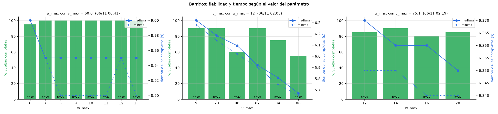

| v_max | Completas | t mediano | t mín | Tiempo previsto 426/(0.94·v) + 0.35 |
|---|---|---|---|---|
| 76 | 18/20 (90 %) | 6.32 | 6.28 | 6.31 |
| 78 | 18/20 (90 %) | 6.19 | 6.14 | 6.16 |
| 80 | 12/20 (60 %) | 6.10 | 6.02 | 6.01 |
| 82 | 18/20 (90 %) | **5.92** | 5.90 | 5.88 |
| 84 | 15/20 (75 %) | 5.81 | 5.75 | 5.75 |
| 86 | 11/20 (55 %) | 5.67 | 5.65 | 5.62 |

- **El tiempo sigue al modelo** con un error de ±0.09 s. Cada m/s ahorra ~0.065 s, sin ningún límite a la vista.
- **La fiabilidad baja, pero no de forma regular.** 80 sale peor que 82 casi seguro por azar: con 20 vueltas, el
  intervalo del 95 % de una proporción del 75 % va del ~51 al ~91 %. La tendencia general es clara: ~90 % hasta
  82 m/s y 55 % a 86.
- **Incluso a 76 m/s hay un 10 % de fallos** con unos parámetros que dieron 3 de 3 en el optimizador. Tres
  repeticiones no bastan para estimar la fiabilidad en este régimen.
- **Dónde falla** (28 fallos):
  - chicane sur, a ~42 m: 7 fallos, todos a v ≥ 78, y 5 de ellos a 80;
  - chicane norte y curva final, a 320–371 m: 12 fallos, la mitad a 86;
  - a 70–81 m: 3 fallos;
  - en mitad del circuito, a 130–250 m: 5 fallos, nuevos de este régimen;
  - a 406 m: 1 fallo.
- **Siguiente:** reoptimizar los parámetros de giro a v_max ≈ 82–86, porque los actuales se ajustaron a 75. Por
  ejemplo, un estudio `simple_v5` con la ventana de `v_max` en 80–92, o barrer `k_hor` y `k_ff` a v_max = 84.

---

## 13. Barrido de `w_max` a 75 m/s y el nuevo límite: la banda del horizonte (2026-11-06, 02:19–02:27)

Base: preset `optuna_simple_v4` (#194, v_max = 75.1). Solo cambia `w_max` = 12, 14, 16 y 20, con 20 vueltas por valor
en orden intercalado. Datos en `logs/optuna/barrido_w_max_20261106-021947.csv` y telemetría en
`logs/20261106-020630_panel.csv`.

| w_max | Completas | t medio (completas) | Saturación en la vuelta | Saturación en la chicane norte | Máx. \|w\| usado | Cambios de signo de w/s | e_ctl rms |
|---|---|---|---|---|---|---|---|
| 12 | 17/20 (85 %) | 6.374 ± 0.004 | 8.1 % | 23.5 % | 12.0 | 2.91 | 83 px |
| 14 | 18/20 (90 %) | 6.367 ± 0.003 | 3.3 % | 12.5 % | 14.0 | 2.80 | 81 px |
| 16 | 16/20 (80 %) | 6.359 ± 0.003 | 0.8 % | 6.1 % | 16.0 | 2.49 | 80 px |
| 20 | 17/20 (85 %) | 6.351 ± 0.003 | 0 % | 0 % | 16.6 | 2.71 | 78 px |

- **El simulador obedece giros de hasta ~16.5 rad/s** (wz/w = 0.986). Con w_max = 20 el coche nunca pide más de
  16.6, así que la saturación desaparece.
- **El tiempo mejora, aunque muy poco:** −0.023 s de 12 a 20 (Kruskal-Wallis, p < 0.001). Equivale a medio
  fotograma.
- **La fiabilidad no cambia.** Está entre el 80 y el 90 % en los cuatro valores, una diferencia dentro del ruido
  (Fisher, 12 frente al resto: p = 1). El 10–15 % de fallos a 75 m/s **no se debe a la saturación del giro**.
- **Dónde falla:** 12 fallos. Solo 2 son en la chicane sur (41–42 m); 2 son a 57–76 m, 7 a 121–225 m (en mitad del
  circuito: la curva oeste y la transición hacia el norte) y 1 a 297 m.

### Mecanismo: el horizonte se vuelve inestable a alta velocidad

En los fallos de mitad del circuito, la telemetría muestra siempre lo mismo:

- `e_hor` cambia de signo de un fotograma a otro, saltando ±100–175 px.
- El término HOR aporta casi todo el giro (10–14 rad/s), mientras P, D y FF casi no aportan.
- El coche entra en un zigzag que crece en 3–5 fotogramas hasta salirse.

Medido en los 49 fallos y las 429 vueltas completas con w_max ≥ 12 (`simple_v4` y los dos barridos):

| | Fallos (último 0.5 s) | Vueltas completas (vuelta entera) |
|---|---|---|
| Parte del giro que pone el horizonte | **65 %** (domina en el 61 % de los fallos) | 48 % |

| v_max | Salto de e_hor entre fotogramas (mediana) | p95 | Paso de giro que puede meter el horizonte (k_hor = 0.064 × p95) |
|---|---|---|---|
| 60–70 | 12 px | 59 px | 3.8 rad/s |
| 70–76 | 13 px | 81 px | 5.2 rad/s |
| 76–80 | 20 px | 112 px | 7.2 rad/s |
| 80–84 | 27 px | 131 px | 8.4 rad/s |
| 84–90 | 31 px | 128 px | 8.2 rad/s |

A más velocidad, el coche avanza más entre fotogramas (3.8 m a 76 m/s, 4.3 m a 86), y la línea en el horizonte
salta más de una imagen a la siguiente. Como el horizonte se suma a `w` **sin filtrar** y con una ganancia fija, a
partir de ~80 m/s puede meter 7–8 rad/s de golpe en un solo fotograma. Con w_max = 12 la saturación lo recortaba en
parte, así que quitar la saturación no ayuda: la causa es el término en sí.

### Conclusión y siguiente

- `w_max` ya no es un límite. Se puede dejar en 12–16: 16 tiene la menor oscilación medida (2.49 cambios/s).
- **El límite actual es la banda del horizonte a alta velocidad.** Domina el giro en el 61 % de los fallos con
  w_max ≥ 12, y su salto entre fotogramas crece con la velocidad. Opciones, de menos a más cambio:
  1. **Barrer `k_hor` a v_max = 82–84** (por ejemplo 0.03, 0.04, 0.05, 0.064): el óptimo de 0.064 se buscó a 75 m/s.
  2. **Escalar `k_hor` con la velocidad** (k_hor / (1 + k·v)), como `kv_kp` hace con Kp.
  3. **Filtrar `e_hor`** (filtro de primer orden o límite de variación por fotograma), como ya se filtra la D. Es un
     cambio del controlador (`src/follow_line.py`).

## 14. Barridos de `k_hor`, `v_max` y filtro del horizonte (2026-11-06, 13:25–14:30)

Base: preset `optuna_simple_v4` (#194) con w_max = 12, 20 vueltas por valor en orden intercalado.

### `k_hor` a v_max = 84 (`logs/optuna/barrido_k_hor_20261106-132512.csv`)

| k_hor | Completas | Mediana | J media | Cambios de signo de w/s |
|---|---|---|---|---|
| 0.03 | 6/20 (30 %) | 5.97 | 54.6 | 1.92 |
| 0.04 | **20/20 (100 %)** | 5.92 | **7.3** | 2.00 |
| 0.05 | 19/20 (95 %) | **5.87** | 10.5 | 2.34 |
| 0.064 | 15/20 (75 %) | 5.90 | 26.1 | 3.74 |

- Con poco horizonte (0.03) el coche no anticipa: casi todos los fallos son en la curva de los ~350 m.
- Con mucho (0.064) oscila: casi el doble de cambios de signo de w, y fallos repartidos por el circuito.
- **El óptimo baja con la velocidad:** 0.064 a 75 m/s (simple_v4), 0.04–0.05 a 84.

### `v_max` con k_hor = 0.045 (`logs/optuna/barrido_v_max_20261106-134340.csv`)

| v_max | Completas | Mediana | J media |
|---|---|---|---|
| 84 | 18/20 (90 %) | 5.89 | 13.6 |
| **86** | **20/20 (100 %)** | **5.76** | **7.1** |
| 88 | 16/20 (80 %) | 5.66 | 19.8 |
| 90 | 15/20 (75 %) | 5.56 | 23.5 |

El tiempo sigue bajando en proporción a 1/v_max. 9 de los 11 fallos son choques en la curva de los ~350 m.
90 % frente a 100 % con 20 vueltas no es una diferencia significativa.

### Filtro de `e_hor` a v_max = 88, k_hor = 0.064 (`logs/optuna/barrido_tau_hor_20261106-140741.csv`)

Se probó un paso bajo de primer orden, `e_f += dt/(τ+dt)·(e_hor − e_f)`, con un parámetro nuevo `tau_hor`:

| tau_hor | Completas | Mediana |
|---|---|---|
| 0 (sin filtro) | 15/20 (75 %) | 5.65 |
| 0.05 | 0/20 | — |
| 0.10 | 0/20 | — |
| 0.15 | 0/20 | — |

Con cualquier filtro el coche choca en la primera curva (~62 m). La telemetría (`logs/20261106-140741_panel.csv`)
muestra `e_hor` oscilando ±200 px y w saturado en ±12: **el horizonte forma parte del lazo de giro, y retrasarlo
aunque sea un fotograma lo vuelve inestable.** Los saltos de §13 no son ruido que haya que limpiar: la oscilación con
k_hor alto es falta de margen de ganancia. El filtro se quitó del controlador.

### Conclusión

- Mejor fiable: **5.76 s en 20/20** (v_max = 86, k_hor = 0.045). Mejor tiempo: 5.56 s (v_max = 90, 15/20).
- `k_hor` debe bajar al subir la velocidad, no filtrarse. El estudio `simple_v5` (`config_v5.json`) busca
  v_max en [84, 92] con k_hor en [0.035, 0.06]. Si el óptimo de k_hor sigue cayendo con v_max, el siguiente paso es
  escalarlo dentro de la vuelta (k_hor / (1 + k·v)), como `kv_kp` con Kp.

## 15. `simple_v5`: de 5.76 s a 5.25 s, y el techo de la chicane norte (2026-11-06, 14:20–16:48)

Datos: **1338 ensayos** de `simple_v5` (g0–g6) con `config_v5.json`. Junto con `simple_v4` forman el régimen
w_max = 12 (1639 ensayos), que ahora tiene sus propias figuras con sufijo `_w12`.

### Evolución

| Generación | Ensayos | Completas | v_max | Mejor vuelta |
|---|---|---|---|---|
| g0 | 50 | 50 % | 84–92 | 5.43 |
| g1 | 84 | 80 % | 88.7–94 | 5.31 |
| g2–g3 | 56 | 60–73 % | 89–96.5 | 5.29 |
| g4 | 856 | 64 % | 92.3–96.7 | 5.22 |
| g5–g6 | 320 | 50–62 % | 93.5–101 | **5.18** |

La ventana móvil subió v_max sola de [84, 92] a [93, 102]. El mejor por J media de sus repeticiones es el
**#775: 5.25 s en 4 de 4** (v_max = 95.5, k_v_curva = 2.63, kp = 0.0103, td = 0.078, k_hor = 0.044), guardado como
preset `w12_v95_n775`. Ningún candidato llegó a 5 repeticiones: el modelo seguía encontrando otros parecidos.

### Frontera velocidad ↔ fiabilidad

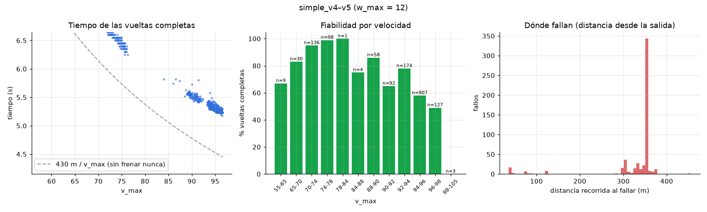

| v_max | Ensayos | Completas | t mediano | v media / v_max |
|---|---|---|---|---|
| 88–90 | 58 | 86 % | 5.56 | 0.86 |
| 90–92 | 92 | 65 % | 5.49 | 0.86 |
| 92–94 | 174 | 78 % | 5.35 | 0.85 |
| 94–96 | 907 | 58 % | 5.30 | 0.85 |
| 96–98 | 127 | 49 % | 5.24 | 0.85 |

- **Rendimientos decrecientes:** de 94 a 96 m/s la mediana solo baja 0.06 s, mientras la fiabilidad cae del 78 al
  49 %. El coche va al 85 % de v_max de media (al 88 % a 75 m/s): a esta velocidad frena más en curva.
- **Una sola curva:** el **67 % de los fallos** son entre 350 y 360 m, en la chicane norte. Le siguen 300–310 m (8 %) y
  330–340 m (6 %).
- **Repetibilidad:** a v_max ≥ 92, de los parámetros que completan la primera vuelta solo el 64 % completa las
  repeticiones (72/113). A 70–84 m/s era el 96 %. Un 3 de 3 o un 4 de 4 a 95 m/s no garantiza fiabilidad.

### Qué parámetros importan con w_max = 12

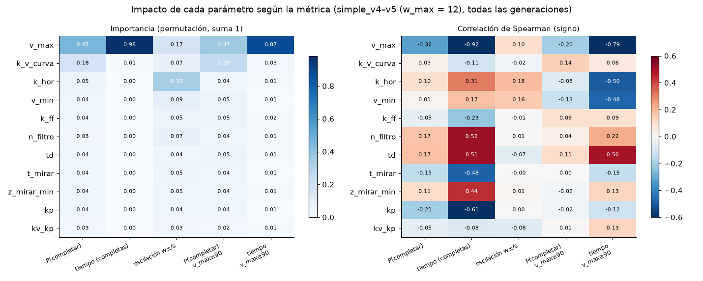
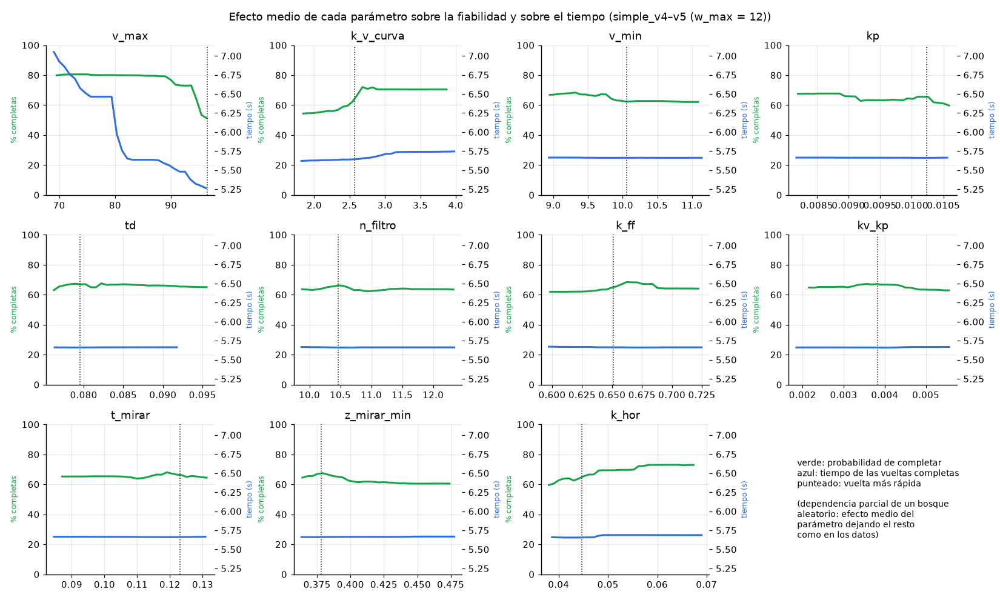
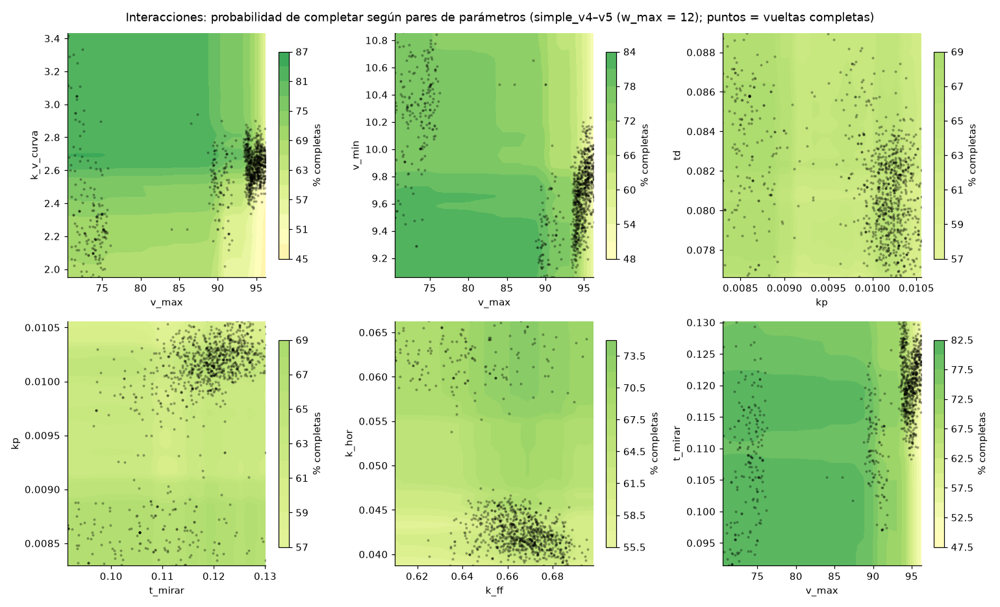

- **Tiempo:** v_max explica casi todo (98 %, R² = 0.99). Con magnitudes físicas, se reparte entre la velocidad en curva
  `v_curva` (58 %) y v_max (41 %).
- **Fiabilidad:** v_max (45 %) y k_v_curva (18 %). Con magnitudes físicas, `v_curva` sola explica el 54 %. A
  v_max ≥ 90, el modelo apenas predice qué vuelta completa (AUC = 0.61): dentro de la ventana, los parámetros explican
  poco y domina el azar de la vuelta.
- **Oscilación:** la marca k_hor (34 %), como en `simple_v3`.

### Palancas a v_max ≥ 90

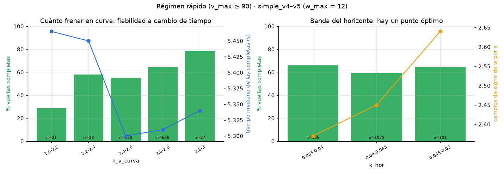

| k_v_curva | Ensayos | Completas | t mediano |
|---|---|---|---|
| 1.5–2.2 | 21 | 29 % | 5.46 |
| 2.2–2.4 | 38 | 58 % | 5.45 |
| 2.4–2.6 | 553 | 55 % | 5.30 |
| 2.6–2.8 | 656 | 64 % | 5.31 |
| 2.8–3.0 | 37 | **78 %** | 5.34 |

Frenar algo más en curva (k_v_curva 2.8–3.0) sube la fiabilidad del 55–64 al 78 % y solo cuesta ~0.03 s. Hay pocos
ensayos en ese tramo porque la ventana se quedó en torno a 2.6. En cambio, k_hor entre 0.035 y 0.05 no cambia la
fiabilidad (59–66 %).

### Tendencia del PID al pasar de 75 a 96 m/s


Con w_max = 12, los buenos parámetros se mueven así al subir v_max (Spearman): la mirada adelantada `L_max` (+0.86, de
8.5 a 11.8 m), la ganancia del lazo (+0.81), kp (+0.74, de 0.0085 a 0.0103) y t_mirar (+0.66) suben; td (−0.73),
z_mirar_min (−0.69), n_filtro (−0.66), k_hor (−0.45, de 0.064 a 0.044) y v_min (−0.45) bajan. El PID se vuelve más
proporcional, con menos D, y mira más lejos.

### Telemetría de la chicane norte


Comparando 723 vueltas completas y 553 fallidas a v_max ≥ 93 tramo a tramo (300–380 m):

- **El giro va saturado (|w| = 12) el 45–58 % del tiempo** entre 320 y 370 m, en las vueltas que pasan y en las que
  chocan. El coche va ~180 px desviado de la línea en toda la curva.
- En las vueltas que chocan, el coche llega más lento (68–75 m/s frente a 80–82) y más desviado (e_ctl 185–213 px
  frente a 167–190). El horizonte aporta menos giro (3.7–4.6 rad/s frente a 4.4–5.6).
- Como la saturación es igual de alta en los dos casos, **no está probado que w_max sea la causa** de los choques. Lo
  que sí muestra es que, con w_max = 12, el coche no puede girar más fuerte en esa curva. El simulador obedece hasta
  ~16.5 rad/s (§13), así que hay margen para comprobarlo.

### Conclusión y siguiente

- Mejor: **5.25 s en 4/4** (#775, v_max = 95.5). Mejor fiable con 20 vueltas: 5.76 s en 20/20 (v_max = 86, §14).
- El techo es la chicane norte a ≥ 95 m/s. Hay dos hipótesis, y cada una se comprueba con un barrido sobre #775:
  1. **`w_max` = 12, 14, 16 y 18:** si el problema es que el coche no puede girar más fuerte.
  2. **`k_v_curva` = 2.6, 2.8, 3.0 y 3.2:** si basta con frenar algo más en curva (la palanca de la tabla de arriba).
- Antes de dar por bueno el #775, confirmarlo con 20 vueltas: a esta velocidad, 4 de 4 no basta.


## 16. Barridos sobre #775: w_max = 14 y k_v_curva bajo (2026-11-07, 21:45–22:25)

Datos: 6 barridos de 20 vueltas por valor sobre el preset `w12_v95_n775` (v_max = 95.5), en
`logs/optuna/barrido_*_20261107-*.csv`. Se comprueban las dos hipótesis de §15.


### w_max (hipótesis 1)

| w_max | Completas | Mediana | Fallos en la salida (~43 m) | Fallos en la chicane norte (~350 m) |
|---|---|---|---|---|
| 12 | 8/20 (40 %) | 5.31 | 0 | 9 |
| **14** | **13/20 (65 %)** | **5.24** | 3 | 1 |
| 16 | 9/20 (45 %) | 5.26 | 9 | 1 |
| 18 | 7/20 (35 %) | 5.25 | 9 | 3 |

- **Confirmada:** con w_max ≥ 14 la chicane norte casi deja de fallar. La saturación de §15 sí era la causa.
- Con w_max ≥ 16 aparece otro fallo: choques en la primera curva (~43 m). Esa curva va al límite en todas las vueltas,
  también en las que terminan (e ≈ −290 px de 320 y giro casi al máximo). A 95 m/s el coche avanza ~3.5 m entre
  fotogramas y ve la curva solo ~9 m antes, así que el resultado depende del fotograma en que la detecta: si la ve a
  32–33 m choca 1 de cada 10 veces, a 33–34 m casi 4 de cada 10. El desvío lateral en la recta no influye.
- **w_max = 14** es el compromiso.

### k_v_curva con w_max = 14 (hipótesis 2, al revés)

Juntando los barridos (algunos valores se midieron dos veces):

| k_v_curva | Completas | Mediana | Mínimo | Dónde falla |
|---|---|---|---|---|
| 1.2 | 15/20 (75 %) | **5.12** | **5.11** | chicane norte (305–352 m) |
| 1.4 | 12/20 (60 %) | 5.14 | 5.11 | chicane y 79–130 m |
| 1.6 | 13/20 (65 %) | 5.17 | 5.14 | chicane y ~72 m |
| 1.8 | 34/40 (85 %) | 5.19 | 5.17 | ~72 m y chicane |
| 2.0 | 18/20 (90 %) | 5.21 | 5.18 | ~72 m |
| 2.2 | 33/40 (83 %) | 5.23 | 5.20 | ~72 m |
| 2.4 | 13/20 (65 %) | 5.25 | 5.22 | ~73 m |
| 2.6 | 31/40 (78 %) | 5.27 | 5.23 | ~43 m |
| 2.8–3.2 | 36/60 (60 %) | 5.29–5.34 | 5.25–5.29 | casi todo a ~43 m |

- **Frenar más no ayuda:** de 2.6 a 3.2 es más lento y falla más en la primera curva.
- **Frenar menos acelera** unos 0.02 s por cada 0.2 de k_v_curva, sin un corte claro de fiabilidad hasta 1.2. Por debajo
  de ~1.6 vuelve a mandar la chicane norte.
- Es lo contrario que con w_max = 12 (§15: k_v_curva 1.5–2.2 completaba el 29 %): con más giro disponible, el coche ya
  no necesita frenar tanto en curva.
- **Ruido entre tandas:** 1.8 dio 20/20 en un barrido y 14/20 en el siguiente. Con 20 vueltas, diferencias de ±10–15
  puntos de fiabilidad no son significativas; para comparar hay que juntar tandas.

### Conclusión y siguiente

- Mejor rápido: **5.12 s de mediana (15/20)** con k_v_curva = 1.2 (preset `w14_v95_kvc12`). Mejor fiable:
  **5.19 s (34/40, 85 %)** con k_v_curva = 1.8 (preset `w14_v95_kvc18`). Los dos con w_max = 14 y el resto de #775.
- Los barridos de un solo parámetro ya dan diferencias del tamaño del ruido. Se lanza `simple_v6` (`config_v6.json`):
  w_max = 14 fijo, k_v_curva en [1.0, 2.2], v_max en [93, 100] y ±20 % alrededor de #775 en el resto, para que el
  optimizador ajuste el PID y la mirada adelantada a la chicane norte con k_v_curva bajo.

## 17. `simple_v6`, barridos de fiabilidad y `simple_v7` (2026-11-07 22:29 – 2026-11-08 02:28)

### `simple_v6`: el más rápido (719 ensayos)

`config_v6.json`: w_max = 14 fijo, k_v_curva en [1.0, 2.2], v_max en [93, 100] y ±20 % alrededor de #775. La ventana de
v_max subió sola hasta 94.75–101.8. A los ~200 ensayos se estancó: **mediana de ~5.0 s, mejor vuelta 4.94 s** y un 60 %
de vueltas completas. Su mejor combinación por repeticiones (v_max 99.7, k_v_curva 1.70, kp 0.0114, td 0.063,
k_ff 0.643, k_hor 0.036) completó 3 de 3 a 4.99 s y se guardó como preset `w14_v99_v6`.

### Barridos de v_max y t_mirar sobre esa combinación

| v_max | Completas | Mediana | Dónde falla |
|---|---|---|---|
| 86 | 14/20 (70 %) | 5.67 | primera curva (~72 m) |
| 88 | 15/20 (75 %) | 5.56 | primera curva y ~125 m |
| 90 | 31/40 (78 %) | 5.44 | primera curva |
| 91 | 18/20 (90 %) | 5.39 | ~72 m |
| 92 | 37/40 (92 %) | 5.34 | 43 m y ~126 m |
| **93** | **20/20 (100 %)** | **5.29** | — |
| 95 | 17/20 (85 %) | 5.21 | chicane y ~72 m |
| 97–99.7 | 61/80 (76 %) | 5.00–5.13 | sobre todo la chicane norte |

- **Por encima de ~95 m/s falla la chicane norte** (300–370 m): en las vueltas que chocan la cámara pasa de ver 13 filas
  a 8 hacia los 302 m, el coche frena a ~58 m/s y no se recupera.
- **Por debajo de 92 falla la primera curva**: los parámetros están ajustados para ~99 m/s y no encajan a otra velocidad.
- 92–93 m/s es el punto dulce: 57/60.

Barrido de `t_mirar` a 93 m/s (40 vueltas por valor): 0.06–0.08 fallan casi siempre en la chicane (1/6), 0.09 y 0.10
dan 35/40 y **0.116 (el de la combinación) da 38/40**. Por encima de ~0.10 el coche ya mira al límite de lo que ve la
cámara (~9 m) en recta, así que `t_mirar` no sirve para ver antes la primera curva.

### `simple_v7`: fiabilidad y estabilidad (1009 ensayos)

`config_v7.json`: v_max fija en 93, J con más peso a la estabilidad (peso_e_rms 0.5 → 2.0, peso_cambios_w 0.1 → 0.3) y
la opción nueva `repetir` = 5 del optimizador: un candidato que completa se repite enseguida hasta 5 veces y se deja al
primer fallo. Solo un candidato con las 5 vueltas puede ser el mejor; los mejores se confirman hasta 10.

- 67–90 % de vueltas completas por generación. El mejor candidato completó **10/10 a 5.30 s con e_rms 213 px**
  (la combinación de partida: 222 px), con td 0.069, k_ff 0.58, k_v_curva 1.98 y t_mirar 0.140. No llegó a 20 vueltas.
- **Fallo del cronómetro encontrado y corregido** (`tools/panel/panel.py`): tras un choque, el primer fotograma de la
  vuelta nueva aún traía la posición del choque y el siguiente ya estaba en la salida; ese salto cruzaba la meta y
  cerraba una vuelta «completa» de 0.4–0.6 s. Pasó 3 veces en ~650 vueltas (2 en ensayos de `simple_v7`, que los
  ponían como «mejores» con 4.4 s de media; se marcaron como fallidos). En los estudios y barridos anteriores no
  ocurrió nunca. Ahora un salto de más de 250 m/s entre fotogramas no cuenta como paso por meta, la meta se fija en la
  salida en el primer reinicio (antes era el primer punto visto, y un panel reiniciado con el coche en marcha la dejaba
  a mitad de circuito) y el optimizador descarta las vueltas completas de menos del 80 % de la distancia.

## 18. Macroanálisis final y parámetros elegidos (2026-11-08)

Datos: **5531 ensayos** de `simple_v1`–`simple_v7` y 15 barridos (1346 vueltas más). `macro_analisis.py` añade el
régimen w_max = 14 (`simple_v6`–`v7`, figuras con sufijo `_w14`) y una sección de decisión (figura 10).


### Régimen w_max = 14

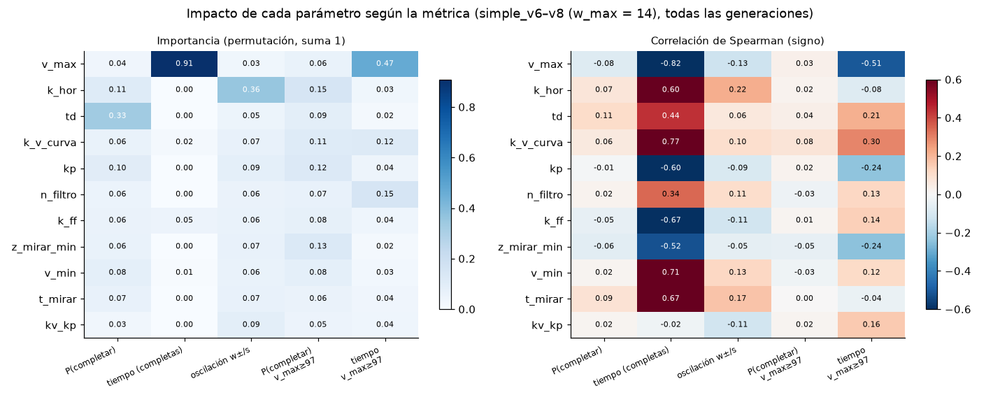
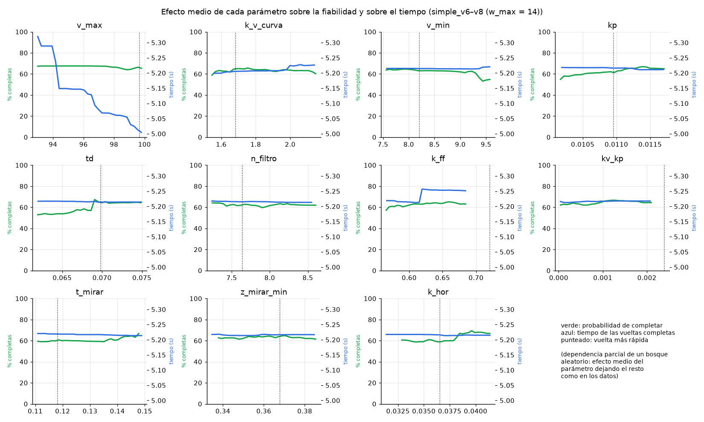

- **Tiempo:** v_max explica el 91 % (R² = 0.90). Con magnitudes físicas, la velocidad en curva `v_curva` el 80 %.
- **Fiabilidad:** la importancia la encabezan **td (31 %)**, k_hor (14 %) y kp (11 %). Con magnitudes físicas: td 0.24,
  k_hor 0.19 y v_min 0.12. Con td ≥ 0.069 la probabilidad de completar sube de ~55 % a ~67 % (dependencia parcial), y
  con k_hor ≥ 0.039 de ~59 % a ~68 %. La v_max apenas cuenta dentro de 93–100 (4 %): lo que decide es cómo gira, no
  cuánto corre. El modelo predice poco (AUC = 0.72): sigue habiendo mucho azar en cada vuelta.
- **A v_max ≥ 97 (`simple_v6`) no se predice nada:** AUC 0.46 para completar y R² 0.11 para el tiempo. A esa
  velocidad, que la vuelta termine depende del fotograma en que se ve la curva, no de los parámetros.
- **Oscilación:** el modelo no la predice (R² < 0). k_hor tiene el mayor peso (34 %, y sube la oscilación:
  Spearman +0.22), pero no es fiable.
- **Dónde falla:** 300–310 m (16 %), 350–360 m (12 %), primera curva 40–50 m (9 %) y 120–130 m (8 %).

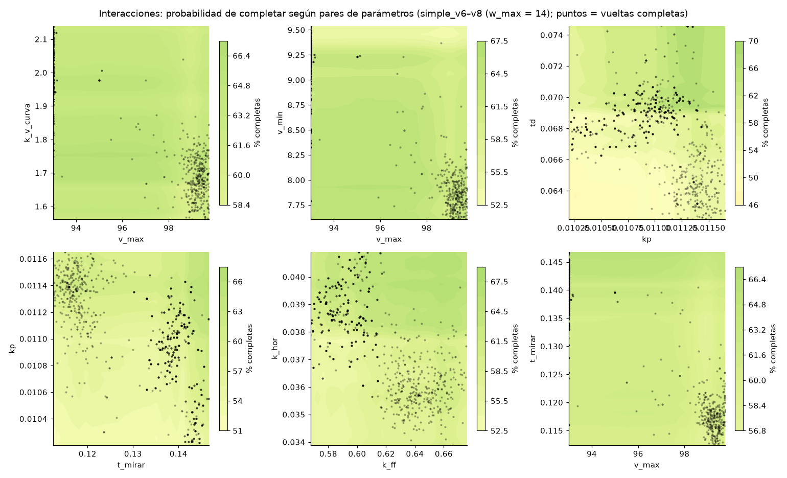

- **kp × td** es la interacción más clara: con td ≥ 0.069 y kp ≥ 0.011 se completa el ~68 %, y con td < 0.066 y
  kp < 0.0105, menos del 50 %. Los dos juntos dan más amortiguamiento al lazo.
- **k_hor × k_ff:** con k_hor ≥ 0.039 y k_ff ≥ 0.62 se pasa del ~55 al ~66 %. Los dos son la parte anticipativa del giro.
- v_max, k_v_curva, v_min y t_mirar apenas cambian el mapa dentro de sus ventanas.

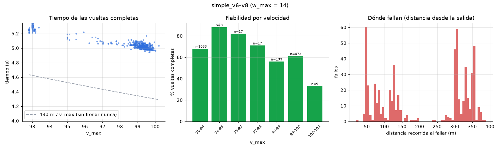
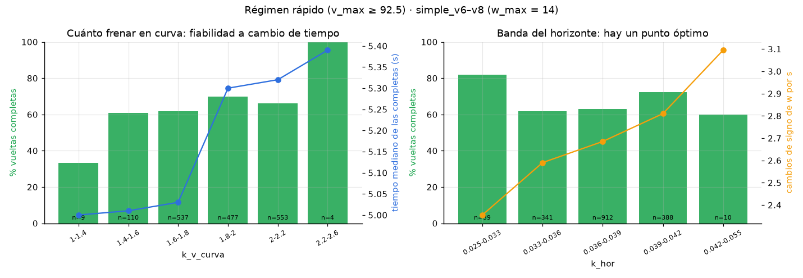

| v_max | Ensayos | Completas | t mediano |
|---|---|---|---|
| 90–93.5 | 1010 | 68 % | 5.31 |
| 95–97 | 13 | 85 % | 5.12 |
| 97–98 | 17 | 71 % | 5.06 |
| 98–99 | 133 | 56 % | 5.04 |
| 99–100 | 473 | 61 % | 5.01 |
| 100–103 | 9 | 33 % | 4.97 |

En el optimizador, la fiabilidad se queda en el 56–68 % a cualquier velocidad, porque mezcla candidatos buenos y
malos. La de una combinación concreta y bien ajustada es mucho mayor (97 % la elegida, tabla de abajo).

### Tendencia y telemetría


Con w_max = 14 (verde), al pasar de 93 a ~99.6 m/s los buenos parámetros suben kp (0.0110 → 0.0114), k_ff (0.60 →
0.64) y la ganancia del lazo (0.96 → 1.09), y bajan k_v_curva (1.97 → 1.64), v_min (9.2 → 7.8), td (0.069 → 0.064)
y t_mirar (0.141 → 0.118). Frente a w_max = 12, el PID es más proporcional (kp 0.0103 → 0.011), con menos filtro en
la D (n_filtro 10.4 → 7.6–8.0) y con k_hor más bajo (0.044 → 0.036–0.039). La ganancia del lazo sigue creciendo con
la velocidad en los tres regímenes.


- **Quién gira el coche:** a 90–105 m/s, P + D ponen el 26–27 % del giro (el 8–20 % a 35–90 m/s) y FF + HOR el resto.
- **Dónde falla** (2971 vueltas fallidas): casi todo en la chicane sur (salida y primera curva) y en la chicane norte.
- **Derecha:** la vuelta más rápida registrada por el panel, **4.80 s**, es una vuelta lanzada (venía de la anterior,
  sin los 0.35 s del reinicio) con `w14_v95_kvc18`: equivale a ~5.15 s con reinicio. Las vueltas falsas del
  cronómetro (§17) se excluyen.

### Decisión


Se juntan todas las vueltas, de estudios y barridos, de cada combinación exacta de parámetros (4599 combinaciones; 56
con ≥ 20 vueltas). Se elige la de mayor **fiabilidad demostrada**: la cota inferior del 95 % (Wilson) de su tasa de
vueltas completas, que penaliza las rachas cortas (10/10 da una cota del 72 %, 20/20 del 84 %).

| Combinación | Vueltas | Completas | Cota 95 % | Mediana | e_rms |
|---|---|---|---|---|---|
| **`w14_v93_v6` (elegida)** | **65** | **63 (97 %)** | **89 %** | **5.29 s** | **222 px** |
| Misma combinación a 92 m/s | 40 | 37 (92 %) | 80 % | 5.34 s | 232 px |
| Misma a 98 m/s | 20 | 19 (95 %) | 76 % | 5.07 s | 235 px |
| `w14_v95_kvc18` | 41 | 35 (85 %) | 72 % | 5.19 s | 236 px |
| `w12_v86_kh045` | 20 | 20 (100 %) | 84 % | 5.76 s | 225 px |
| `simple_v7`, mejor candidato | 10 | 10 (100 %) | 72 % | 5.30 s | 213 px |

**Elegida: `w14_v93_v6`**, la de mayor cota de todas. Además está en la frontera: ninguna combinación es a la vez más
rápida y más fiable. A 98 m/s la misma combinación dio 19/20 a 5.07 s, pero a 97, 99 y 99.7 dio 65–75 %: esa tanda fue
suerte. Queda como **valor por defecto de `src/follow_line.py`**:

| v_max | k_v_curva | v_min | kp | td | n_filtro | k_ff | kv_kp | t_mirar | z_mirar_min | k_hor | w_max | ti |
|---|---|---|---|---|---|---|---|---|---|---|---|---|
| 93 | 1.697 | 7.79 | 0.01139 | 0.0632 | 7.42 | 0.643 | 0.00054 | 0.116 | 0.370 | 0.0357 | 14 | 0 |

Recuperación: v_perdida = 4, t_perdida_max = 0.8 s, t_atasco = 0.7 s, reinicio automático activado.

### Pendiente

- El mejor candidato de `simple_v7` (td 0.069, 10/10, e_rms 213) y la dependencia parcial apuntan a que subir td a
  ~0.07 y k_hor a ~0.04 daría algo más de fiabilidad y menos oscilación. Habría que confirmarlo con ≥ 40 vueltas antes
  de cambiar el valor por defecto.
- La primera curva sigue fallando ~1 vez de cada 30: depende del fotograma en que se detecta y ningún parámetro lo
  elimina del todo.

## 19. Tandas de 5 vueltas seguidas: `simple_v9` (2026-11-10)

Hasta aquí, cada ensayo era **una vuelta desde parado**: el coche vuelve a la salida antes de cada vuelta. El 97 % de
`w14_v93_v6` mide eso. En `simple_v9`, cada ensayo es una **tanda de 5 vueltas seguidas** con los mismos parámetros y
un solo reinicio al principio (opción `vueltas_seguidas` del optimizador, `config_v9.json`). La tanda solo cuenta
como completa si acaba las 5. El tiempo es la media por vuelta: la 1.ª incluye los 0.35 s del reinicio y las otras
cuatro son **lanzadas**, porque cruzan la meta a toda velocidad. J es la de `simple_v7` y un fallo puntúa por la
distancia recorrida en toda la tanda: chocar en la 4.ª vuelta vale ~77, frente a ~10.5 si acaba las 5. v_max es libre
(la ventana empezó en 93–97 y bajó sola a 91–95). No se importaron ensayos anteriores, porque su J es de una sola
vuelta.

`macro_analisis.py` lo trata en una sección aparte (11) y no lo mezcla con las vueltas sueltas: un ensayo es una
tanda. `simple_v8` (34 ensayos de una vuelta, v_max 93–97) entra en el régimen w_max = 14, que pasa a llamarse
`simple_v6–v8`; no cambia ninguna conclusión de §18.

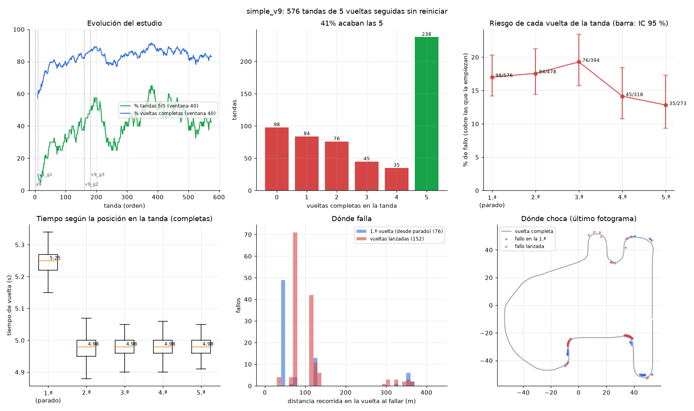

**576 tandas** (16:06–18:56): **41 % acaban las 5** y el 83 % de las vueltas intentadas se completan (1701 de 2039).
Con la convergencia del optimizador, el porcentaje de tandas 5/5 pasó del ~25 % a ~45–60 % (figura, arriba a la
izquierda).

- **El riesgo es parecido en todas las vueltas:** 17 % en la 1.ª, 18 % en la 2.ª, 19 % en la 3.ª, 14 % en la 4.ª y
  13 % en la 5.ª. Las dos últimas salen algo más bajas porque solo llegan a ellas las combinaciones buenas. No hay
  desgaste ni deriva entre vueltas: cada vuelta es un sorteo casi independiente, así que **P(5/5) ≈ p⁵**.
- **Tiempo:** 5.25 s la 1.ª y **4.97–4.98 s cada vuelta lanzada**, muy constante (caja de ±0.03 s).
- **Fallan en sitios distintos** (telemetría del panel, 1525 vueltas):
  - **La 1.ª, desde parado** (18 % de fallos), cae en la **primera curva, 40–50 m (64 %)**, y en 120–130 m (17 %).
  - **Las lanzadas** (14 %) casi nunca fallan ahí. Fallan en las dos curvas siguientes de la chicane sur:
    **70–80 m (47 %)** y **110–120 m (28 %)**.
  - En las lanzadas el error es mayor (e_rms 241 frente a 229 px) y el giro va saturado más tiempo (11 % frente a
    7 %).
  - Hipótesis: al empezar la vuelta lanzada, el coche llega a la chicane con el estado que trae de la vuelta anterior
    (desplazamiento lateral, rumbo, filtro de la D), no centrado y recto como tras el reinicio. Supera la primera
    curva, pero sale de ella peor colocado para las dos siguientes.
- La chicane norte (300–360 m), que en vueltas sueltas a v ≥ 97 daba el 30 % de los fallos, apenas falla aquí: v_max
  se quedó en 91–93.

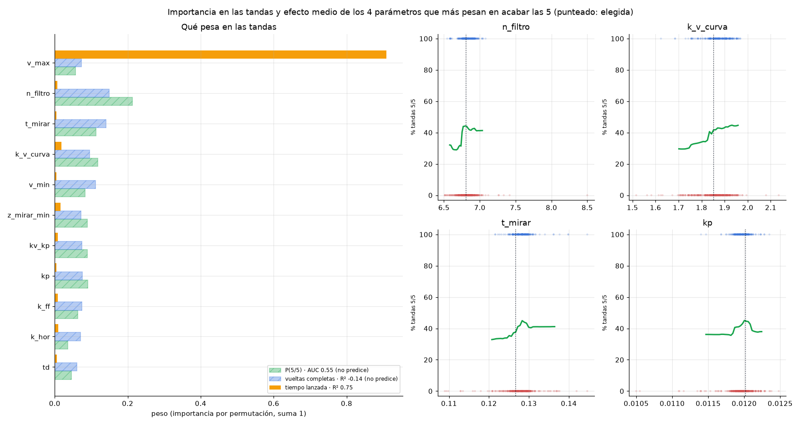

**Qué pesa:**
- **Tiempo:** v_max explica el 91 % (R² = 0.75).
- **Fiabilidad:** el modelo **no predice** (AUC 0.55 para acabar las 5; R² < 0 para el número de vueltas). El
  optimizador convergió pronto a una zona estrecha (kp ≈ 0.012, td ≈ 0.071, n_filtro ≈ 6.8, k_ff ≈ 0.63,
  k_hor ≈ 0.038, t_mirar ≈ 0.128, v_max ≈ 92). Dentro de esa zona, que una tanda salga bien depende del azar, no de
  los parámetros.
- Las dependencias parciales (n_filtro ≥ 6.8, k_v_curva ≥ 1.85 y t_mirar ≈ 0.128 algo mejores) son débiles y no
  conviene leerlas como reglas.
- La zona coincide con lo que §18 recomendaba para una vuelta (td ≈ 0.07, k_hor ≈ 0.039, kp ≥ 0.011), con algo más
  de kp y menos filtro de la D.

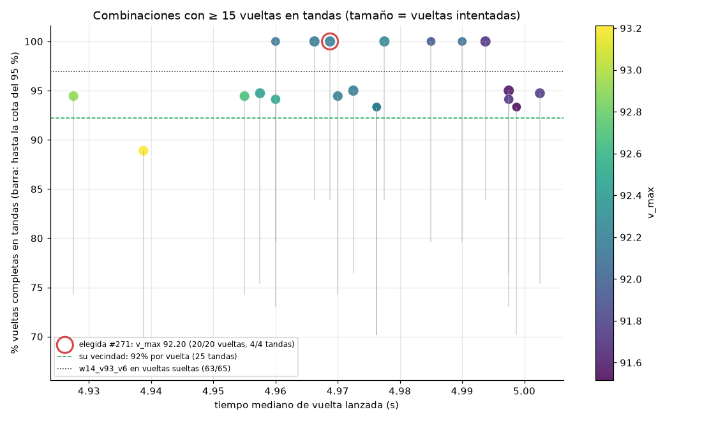

### Decisión en tandas

Se agrupan las tandas por combinación exacta. Se ordenan por la cota de Wilson (95 %) de las vueltas completadas sobre
las intentadas, y a igualdad por el tiempo.

| Combinación | Tandas 5/5 | Vueltas | Cota por vuelta | Vuelta lanzada | Media en la tanda | e_rms |
|---|---|---|---|---|---|---|
| **#271 (preset `w14_v92_v9`)** | **4/4** | **20/20** | **84 %** | **4.97 s** | **5.02 s** | **235 px** |
| #411 | 4/4 | 20/20 | 84 % | 4.97 s | 5.03 s | 234 px |
| #171 | 4/4 | 20/20 | 84 % | 4.98 s | 5.03 s | 241 px |
| #426 | 4/4 | 20/20 | 84 % | 4.99 s | 5.05 s | 232 px |
| Vecindad de #271 (±15 % de la ventana, 12 combinaciones) | 17/25 (68 %) | 95/103 (92 %) | 85 % | 4.97 s | — | — |
| `w14_v93_v6` en tandas | 0/1 | 0/1 | — | — | — | — |

Elegida en tandas: **#271**, v_max 92.2, k_v_curva 1.852, v_min 7.41, kp 0.01202, td 0.0715, n_filtro 6.81,
k_ff 0.629, kv_kp 0.0014, t_mirar 0.1267, z_mirar_min 0.316, k_hor 0.0382 (w_max 14, ti 0).

**Lectura:**
- **Velocidad:** una vuelta lanzada tarda **4.97 s**, frente a los 5.29 s de `w14_v93_v6` desde parado. Casi
  toda la diferencia viene de no reiniciar: la 1.ª vuelta de la tanda, desde parado, tarda 5.25 s.
- **Fiabilidad:** las 4 combinaciones con 20/20 son el mejor resultado posible con 20 vueltas, pero su vecindad, casi
  los mismos parámetros, da un **92 % por vuelta** y un **68 % de tandas 5/5**. Seguramente ahí está la fiabilidad
  real de la zona; los 20/20 tienen parte de racha.
- **Comparación:** con el 97 % por vuelta de `w14_v93_v6` en vueltas sueltas, cabría esperar un 86 % de tandas 5/5.
  No sabemos si ese 97 % se mantiene en vueltas lanzadas: en tandas solo se probó una vez (chocó en la 1.ª).

### Pendiente

- **Confirmar con ≥ 10 tandas (50 vueltas)** `w14_v92_v9` (#271) y `w14_v93_v6` en las mismas condiciones, para
  saber cuál es más fiable encadenando vueltas. Ahora `barrido.sh` hace vueltas sueltas: habría que darle la opción
  de tandas.
- **Atacar la chicane sur en vueltas lanzadas** (70–80 m y 110–120 m): ver en la telemetría con qué desplazamiento y
  rumbo cruza la meta el coche y si el término D o la banda del horizonte llegan saturados a la primera curva.
